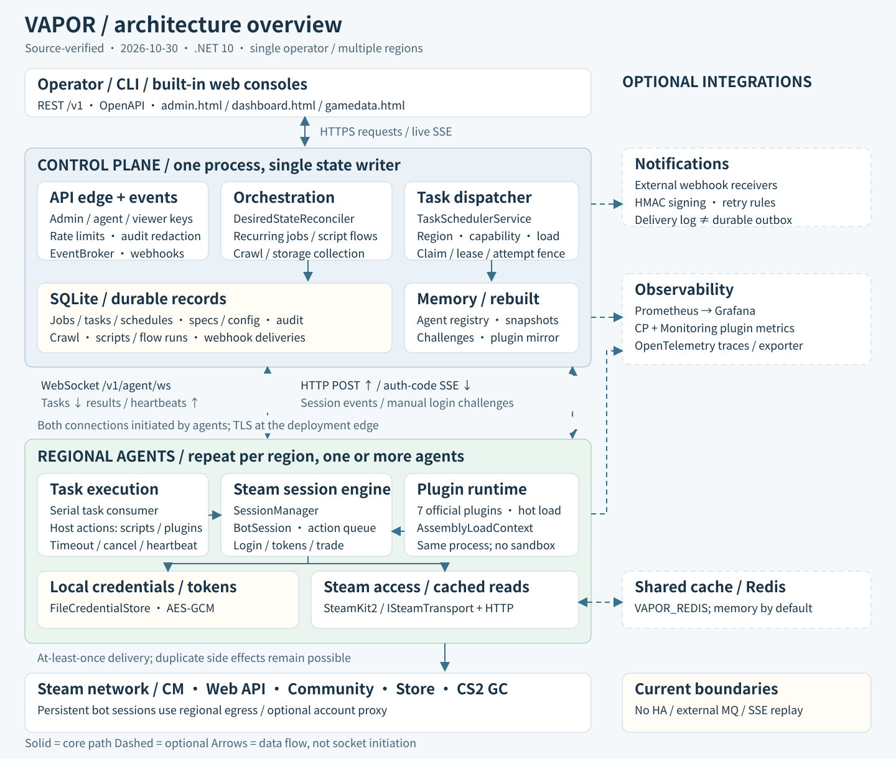

<p align="center">
  
</p>

<div align="center">

English | [简体中文](README.zh.md)

</div>

# Vapor — Distributed Steam Automation Control Plane

[](https://github.com/cuihairu/vapor/actions/workflows/ci.yml) [](https://codecov.io/gh/cuihairu/vapor) [](https://github.com/cuihairu/vapor/releases) [](LICENSE) [](https://dotnet.microsoft.com/) [](https://learn.microsoft.com/dotnet/csharp/) [](#development-status)

API-controlled, headless Steam automation platform designed for large-scale batch operations and multi-region deployment. Inspired by [ArchiSteamFarm](https://github.com/JustArchiNET/ArchiSteamFarm)'s Bot/Action model.

The Steam protocol layer is built on [SteamKit2](https://github.com/SteamRE/SteamKit); the product shape reuses ASF's bot-session concepts in a control-plane / agent split instead of one process per machine. One control plane can steer agents in every region, close to Steam's regional endpoints. Agents reach the control plane, never the other way around.

## Highlights

Each account runs as a persistent Steam bot session: credential login with token refresh, SteamGuard / 2FA challenges, TOTP and QR-code login, and `.maFile` import from SDA or steamguard-cli. On top of that sit 65 actions — card farming, playtime boosting, trade offers, market listings with fee-aware pricing, inventory and duplicate scanning, achievement management, key redemption, free-license and points-shop claims, plus the Dota 2 trading plugin. Every action carries an execution-safety class, which is what lets the scheduler cap redispatch at 2 attempts for actions whose repetition can double an external side effect, while read-only and idempotent actions keep the configured ceiling. The [actions catalog](docs/actions.md) lists every payload field.

Declarative orchestration: you state `online` / `idle` / `farm` / `boost` per account and the reconciler converges reality to that statement, rotating farming targets as card drops run out and reassigning accounts when an agent disappears. `GET /v1/orchestration/farm` shows the live loop.

Risky surfaces ship disabled. Market listing creation and cancels default to `dry_run` and need both a per-account and a per-agent switch; trade auto-accept requires an explicit per-account policy with a partner whitelist and gifts-only mode. Every one of those decisions lands in the audit log.

Plugins load into isolated AssemblyLoadContexts and unload without a restart. Manifests carry a SemVer API contract, a trust level and permission grants; the runtime PluginStore installs packages agent-targeted from a catalog. Seven official plugins ship in-tree: Monitoring, MobileAuthenticator, MarketWatch, CS2/CSGO, Dota 2, GameData, GameAccess — the last carrying the game-access action surface as a wire-compatible extraction from the host. See [plugin development](docs/plugins.md).

For operations: a control-plane script repository to store and dispatch operator scripts to connected agents plus ordered script flows (sequential steps, per-step status, stop/continue failure policy), OpenAPI/Swagger, SSE event streams (jobs, sessions, auth challenges), Prometheus metrics with a Grafana dashboard, OpenTelemetry tracing across the agent tunnel, HMAC-signed webhooks, and structured logs that redact credentials and codes at output. Security posture is AES-GCM encrypted credential stores with key rotation tooling, per-role API keys, and an audit log redacted at rest. Agent-local tokens use encrypted storage; manual codes pass through the control plane to agents, while webhooks receive only `codeSupplied`. Credentials submitted in task payloads enter control-plane persistence; see the [architecture review](docs/review/architecture-2026-10-30.md).

## Architecture at a glance



A single control plane drives regional agents through SQLite task leases. Agents initiate WS and HTTP connections; plugins share the session-engine process. Dashed lines mark optional integrations.

[Full-size SVG](docs/assets/architecture/overview.en.svg) · [Architecture](docs/architecture.md) · [Source review and gaps](docs/review/architecture-2026-10-30.md)

## Live demo

**Demo site https://vapor.cuihairu.site/ | demo account `demo` / `demo-899d0e86ad4d1c524da9c47a9d0f160e` (for trial use, data resets periodically)**

- The demo key is a dedicated **read-only sandbox**: it authenticates
  reads (GET/HEAD) on the REST API and both consoles, while every write — job
  creation, account changes, agent dispatch — is rejected with `401`. The real
  admin key lives only on the deploy machine and is never published.
- Sign-in: open [`/admin.html`](https://vapor.cuihairu.site/admin.html) (admin console)
  or [`/dashboard.html`](https://vapor.cuihairu.site/dashboard.html) (read-only dashboard)
  and paste the demo password into the API-key prompt.
- Deployed by CI straight from `main`: deploys happen only when the full test
  gate (all-green suite + 100% line/branch coverage) and the image build are
  green, with automatic rollback on failure. Demo data is reset on every
  deploy — a demo agent stays connected and seeded demo accounts/jobs keep the
  consoles populated.
- The demo account exists for demonstration only (it is not a real admin account); never enter real Steam credentials into the demo instance.

### Preview

| Control plane console | Account overview |
|---|---|
|  |  |
| **Job history** | **Live event stream** |
|  |  |

## Quick start

Docker Compose (control plane + one agent):

```bash
git clone https://github.com/cuihairu/vapor.git
cd vapor
docker compose up -d                                # + --profile observability for Prometheus/Grafana
curl -s http://127.0.0.1:8080/healthz
```

Declare an account and run your first job (dev key defaults, see [docker.md](docs/docker.md) for the variable table):

```bash
curl -sS -X PUT http://127.0.0.1:8080/v1/accounts/acct-1 \
  -H "Authorization: Bearer admin-dev-token" -H "Content-Type: application/json" \
  -d '{"enabled":true,"desiredState":"Online","region":"eu-west","agentId":"agent-1","updatedBy":"quickstart"}'

curl -sS -X POST http://127.0.0.1:8080/v1/jobs \
  -H "Authorization: Bearer admin-dev-token" -H "Content-Type: application/json" \
  -d '{"action":"ping","region":"eu-west","targets":["acct-1"]}'
```

Then open the consoles: [`/admin.html`](http://127.0.0.1:8080/admin.html) (full management UI) · [`/dashboard.html`](http://127.0.0.1:8080/dashboard.html) (read-first, one whitelisted reconcile action) · [`/gamedata.html`](http://127.0.0.1:8080/gamedata.html) (game data dictionary). The full walkthrough — login, challenges, farming, plugins — is in [docs/getting-started.md](docs/getting-started.md).


## Local test policy

CI and local development branch three ways by change surface — a one-line docs
edit should not compile the world.

1. **Docs changes** (`*.md`, `docs/**`, images): no compile. The main CI
   workflow's `paths-ignore` already skips these paths.
2. **Code changes**: run only the affected subset, not the world.
   - `dotnet test <changed csproj>`
3. **Full run** (`dotnet test -c Release`): only triggered by — *.csproj /
   *.sln, `.github/**`, Docker/Compose config, and pre-release.

## Documentation

| Section | Contents |
|---------|----------|
| **Getting started** | [Walkthrough](docs/getting-started.md) · [Local run](docs/running.md) · [Docker & Compose](docs/docker.md) · [Production deployment](docs/production.md) |
| **Reference** | [REST API](docs/api.md) · [Actions catalog](docs/actions.md) · [Data dictionary](docs/data-dictionary.md) · [Performance](docs/performance.md) · [Dependency policy](docs/dependencies.md) · [Releasing](docs/releasing.md) |
| **Design** | [Architecture](docs/architecture.md) · [Domain model](docs/domain-model.md) · [Consistency model](docs/consistency.md) · [Session engine](docs/session-engine.md) · [Plugin development](docs/plugins.md) · [Feature matrix (vs. ASF)](docs/feature-matrix.md) |
| **Operations** | [Troubleshooting](docs/troubleshooting.md) · [Testing](tests/TESTING.md) |
| **Project** | [Changelog](CHANGELOG.md) · [Contributing](CONTRIBUTING.md) · [Security policy](SECURITY.md) · [Support](SUPPORT.md) |

## Requirements

- Runtime: .NET 10 (apps/tests target `net10.0`)
- SDK: 10.x (recommended)
- Language: C# (via Directory.Build.props)

## Testing

- Run tests: `./scripts/run-tests.sh` (or `pwsh ./scripts/run-tests.ps1`)
- Coverage: `./scripts/run-tests.sh --coverage`; full-solution gate runs use `./scripts/collect-coverage-serial.sh` (per-project collection with report validation)
- Tests require the .NET 10 runtime; `DOTNET_ROLL_FORWARD=Major` can bridge an older runtime.

## Releases

- Versions: SemVer tags `vX.Y.Z` (see `docs/releasing.md`)
- Changelog: `CHANGELOG.md`

## Development status

Vapor is currently **alpha** (breaking changes expected).

## License

Apache-2.0, see `LICENSE`.

## Contributing

See `CONTRIBUTING.md` and `SECURITY.md`.

## Support

See `SUPPORT.md`.
