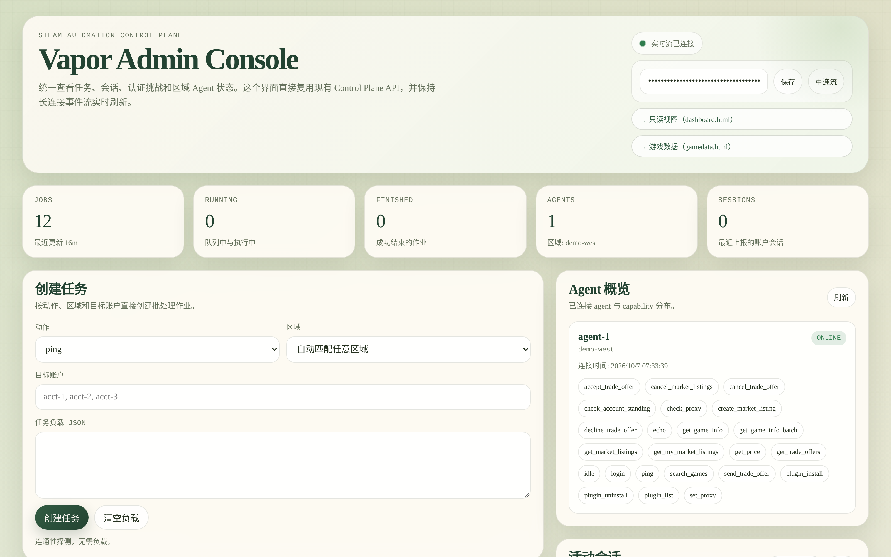
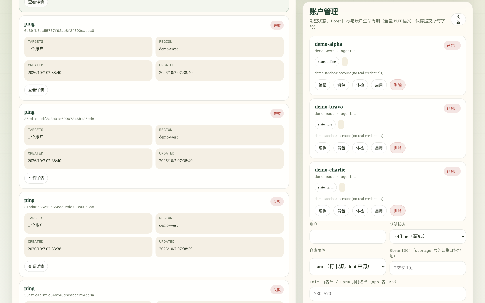
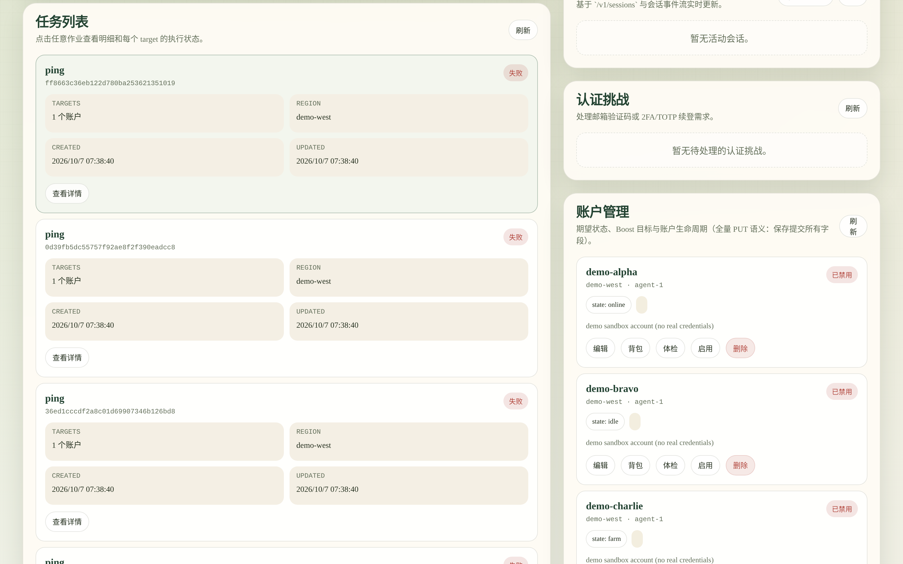
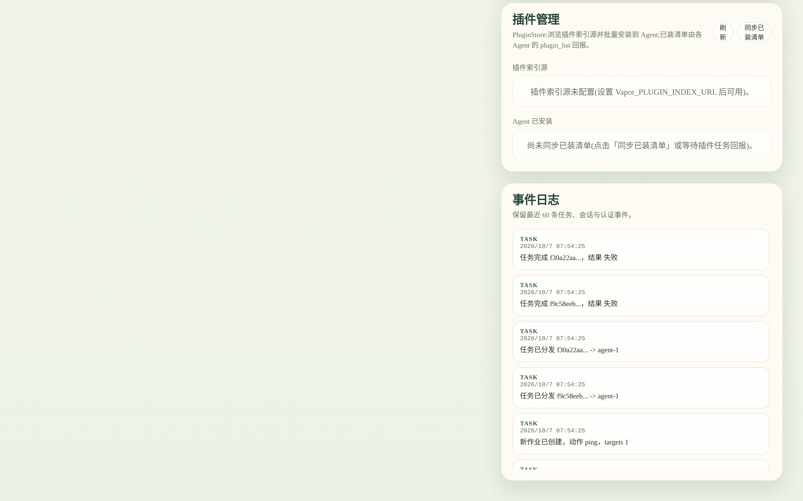

<p align="center">
  
</p>

<div align="center">

[English](README.md) | 简体中文

</div>

# Vapor — 分布式 Steam 自动化控制平面

[](https://github.com/cuihairu/vapor/actions/workflows/ci.yml)
[](https://codecov.io/gh/cuihairu/vapor)
[](https://github.com/cuihairu/vapor/releases)
[](LICENSE)
[](https://dotnet.microsoft.com/)
[](#开发状态)

API 驱动的无头 Steam 自动化平台，面向大规模批量操作与多区域部署。产品形态借鉴 [ArchiSteamFarm](https://github.com/JustArchiNET/ArchiSteamFarm) 的 Bot/Action 模型。

Steam 协议层基于 [SteamKit2](https://github.com/SteamRE/SteamKit)；但落地形态不是「一台机器一个进程」，而是控制平面 / Agent 拆分，复用 ASF 的 bot 会话概念。一个控制平面可以调度各区域的 Agent，就近接入 Steam 各区域端点——由 Agent 主动连控制平面，控制平面从不反向连接。

## 亮点

每个账号跑成常驻 Steam bot 会话：凭据登录与令牌刷新、SteamGuard / 2FA 挑战、TOTP 与扫码登录，以及从 SDA 或 steamguard-cli 导入 `.maFile`。其上是 65 个动作——卡牌挂机、在线时长提升、交易报价、带手续费计算的市场挂单、背包与重复物品扫描、成就管理、Key 兑换、免费许可证与积分商店认领，外加 Dota 2 交易插件。每个动作都带执行安全分级，正因如此调度器对「重复执行会产生外部副作用」的动作把重派上限压到 2 次，而只读与幂等动作沿用配置上限。[动作目录](docs/actions.md) 列出每个动作的载荷字段。

声明式编排：你只声明每个账号的 `online` / `idle` / `farm` / `boost`，调和器负责把现实收敛到该声明——卡牌刷完后轮换挂机目标，Agent 掉线时重新分配账号。`GET /v1/orchestration/farm` 可以看到实时循环。

高风险面默认关闭。市场挂单创建与撤单默认 `dry_run`，且需账号级与 Agent 级双开关；交易自动接受要求显式的账号策略加合作方白名单与「仅礼物」模式。这些决定全部落审计日志。

插件加载进隔离的 AssemblyLoadContext，无需重启即可卸载。清单携带 SemVer API 契约、信任级别与权限授予；运行时 PluginStore 从目录安装面向 Agent 的包。仓内自带七个官方插件：Monitoring、MobileAuthenticator、MarketWatch、CS2/CSGO、Dota 2、GameData、GameAccess——最后一个以线兼容方式从宿主抽出游戏访问动作面。见[插件开发](docs/plugins.md)。

运维侧：控制平面脚本仓库（存放操作脚本并派发给已连接的 Agent）加有序脚本编排（顺序步骤、逐步状态、停止/继续的失败策略）、OpenAPI/Swagger、SSE 事件流（任务、会话、认证挑战）、Prometheus 指标配 Grafana 仪表盘、贯穿 Agent 隧道的 OpenTelemetry 链路追踪、HMAC 签名 webhook，以及在输出侧脱敏凭据与验证码的结构化日志。安全姿态是 AES-GCM 加密凭据存储加密钥轮换工具、按角色的 API Key、落盘即脱敏的审计日志——外加一条硬规矩：Steam Guard 验证码与凭据不出 Agent，跨线的只有一个布尔值。

## 架构速览

```
                    ┌────────────────────────────────────────────┐
                    │               Control Plane                │
   operators ──────▶│  REST /v1 (68 routes / 84 ops) · OpenAPI·SSE│
   (curl / UI)      │  SQLite: jobs · accounts · audit · crawl · scripts │
                    │  DesiredStateReconciler · schedulers       │
                    │  admin.html · dashboard.html · gamedata    │
                    └───────────────┬────────────────────────────┘
                                    │ outbound WSS tunnel (agent key)
                    ┌───────────────┴──────────┐  ┌──────────────┐
                    │         Agent #1         │  │   Agent #N   │   ← one per region
                    │  session engine (bots)   │  │              │
                    │  65 actions · plugins   │  │   plugins    │
                    │  encrypted credentials   │  │              │
                    └───────────────┬──────────┘  └──────┬───────┘
                                    │                    │
                                    ▼                    ▼
                               Steam network       Steam network
```

## 演示站点

**演示站点 https://vapor.cuihairu.site/ ｜ 演示账号 `demo` / `demo-899d0e86ad4d1c524da9c47a9d0f160e`（体验用，数据定期重置）**

- 该演示 Key 是专用的**只读沙箱**：它能通过 REST API 与两个控制台的读接口（GET/HEAD），而任何写操作——创建任务、改账号、派发 Agent——一律返回 `401`。真实管理 Key 只存在于部署机器，从不公开。
- 登录方式：打开 [`/admin.html`](https://vapor.cuihairu.site/admin.html)（管理台）
  或 [`/dashboard.html`](https://vapor.cuihairu.site/dashboard.html)（只读面板），
  在 API Key 框粘贴演示密码即可登录。
- 由 CI 从 `main` 直接部署：只有完整测试门禁（全绿套件 + 行/分支 100% 覆盖率）与镜像构建都绿才发布，失败自动回滚。每次部署都会重置演示数据——演示 Agent 保持在线，预置的演示账号与任务让控制台始终有内容。
- 账号为演示专用（非真实管理员账号）；请勿在演示实例中输入任何真实 Steam 凭据。

### 预览

| 控制台 | 账号总览 |
|---|---|
|  |  |
| **任务历史** | **实时事件流** |
|  |  |

## 快速开始

Docker Compose 起控制平面 + 一个 Agent：

```bash
git clone https://github.com/cuihairu/vapor.git
cd vapor
docker compose up -d                                # 另加 --profile observability 起 Prometheus/Grafana
curl -s http://127.0.0.1:8080/healthz
```

声明账号并跑第一个任务（开发默认 Key，变量表见 [docker.md](docs/docker.md)）：

```bash
curl -sS -X PUT http://127.0.0.1:8080/v1/accounts/acct-1 \
  -H "Authorization: Bearer admin-dev-token" -H "Content-Type: application/json" \
  -d '{"enabled":true,"desiredState":"Online","region":"eu-west","agentId":"agent-1","updatedBy":"quickstart"}'

curl -sS -X POST http://127.0.0.1:8080/v1/jobs \
  -H "Authorization: Bearer admin-dev-token" -H "Content-Type: application/json" \
  -d '{"action":"ping","region":"eu-west","targets":["acct-1"]}'
```

然后打开控制台：[`/admin.html`](http://127.0.0.1:8080/admin.html)（完整管理界面）· [`/dashboard.html`](http://127.0.0.1:8080/dashboard.html)（读优先，仅一个白名单内调和动作）· [`/gamedata.html`](http://127.0.0.1:8080/gamedata.html)（游戏数据字典）。完整走查——登录、挑战、挂机、插件——见[上手指南](docs/getting-started.zh.md)。


## 本地测试口径

CI 与本地开发按改动面三路分流——改一行文档不该全量编译。

1. **文档改动**（`*.md`、`docs/**`、图片）：不编译。主 CI workflow 的
   `paths-ignore` 已跳过这些路径。
2. **代码改动**：只跑改动子集，不全量。
   - `dotnet test <改动 csproj>`
3. **全量**（`dotnet test -c Release`）：仅以下情形触发——*.csproj / *.sln、
   `.github/**`、Docker/Compose 配置、发布前。

## 文档

文档站（https://cuihairu.github.io/vapor/ ）右上角可切换语言；下表直接指向对应语言的文件，尚未翻译的页面暂为英文，后续逐页补齐。

| 章节 | 内容 |
|---------|----------|
| **上手** | [走查](docs/getting-started.zh.md) · [本地运行](docs/running.zh.md) · [Docker 与 Compose](docs/docker.md) · [生产部署](docs/production.md) |
| **参考** | [REST API](docs/api.md) · [动作目录](docs/actions.md) · [数据字典](docs/data-dictionary.md) · [性能](docs/performance.md) · [依赖策略](docs/dependencies.md) · [发布](docs/releasing.md) |
| **设计** | [架构](docs/architecture.md) · [领域模型](docs/domain-model.md) · [一致性模型](docs/consistency.md) · [会话引擎](docs/session-engine.md) · [插件开发](docs/plugins.md) · [功能对照（对 ASF）](docs/feature-matrix.md) |
| **运维** | [故障排查](docs/troubleshooting.md) · [测试](tests/TESTING.md) |
| **项目** | [变更日志](CHANGELOG.md) · [贡献](CONTRIBUTING.md) · [安全策略](SECURITY.md) · [支持](SUPPORT.md) |

## 环境要求

- 运行时：.NET 10（应用/测试目标框架为 `net10.0`）
- SDK：10.x（推荐）
- 语言：C#（经 Directory.Build.props 约定）

## 测试

- 跑测试：`./scripts/run-tests.sh`（或 `pwsh ./scripts/run-tests.ps1`）
- 覆盖率：`./scripts/run-tests.sh --coverage`；全解决方案门禁用 `./scripts/collect-coverage-serial.sh`（按项目收集并校验报告）
- 测试需要 .NET 10 运行时；`DOTNET_ROLL_FORWARD=Major` 可在更旧运行时上桥接。

## 发布

- 版本：SemVer tag `vX.Y.Z`（见 [docs/releasing.md](docs/releasing.md)）
- 变更日志：`CHANGELOG.md`

## 开发状态

Vapor 目前是 **alpha**（可能有破坏性变更）。

## 许可证

Apache-2.0，见 `LICENSE`。

## 贡献

见 `CONTRIBUTING.md` 与 `SECURITY.md`。

## 支持

见 `SUPPORT.md`。