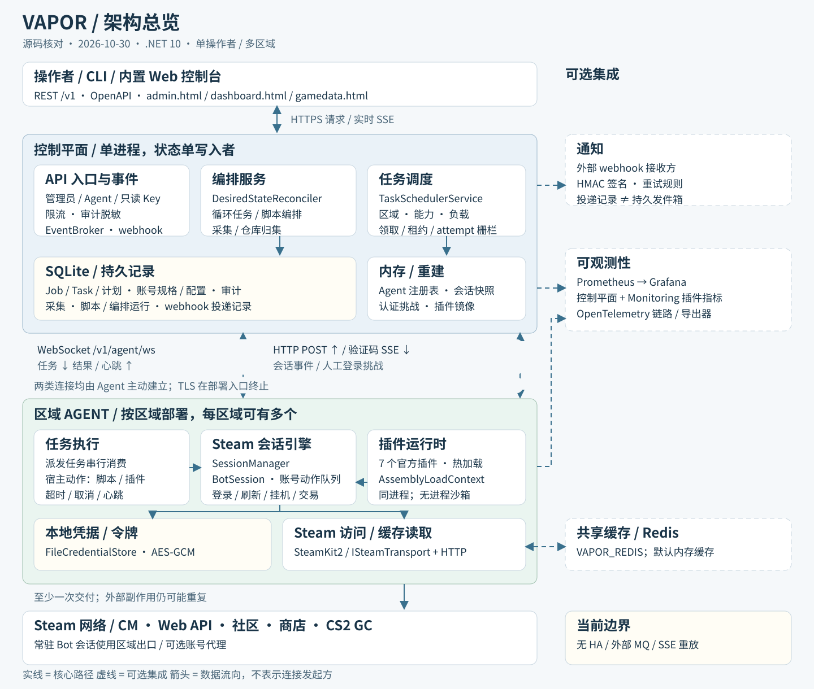

简体中文 | English

# Vapor 架构（ASF 风格）

本项目实现一个由 API 掌控的无头 Steam 自动化平台，思路借鉴 ArchiSteamFarm（ASF）。目标是支撑大规模、多账号的运营：多区域部署 + 集中管理。

## 目标

- 提供面向公网的 HTTP API，用于提交与管理自动化任务。
- 在贴近 Steam / 合作方 / 用户的区域 Agent 上执行任务，压低时延并处理按地域区分的路由。
- 支撑大批量操作，编排可靠（幂等、重试、部分成功）。
- 让 Steam 会话逻辑保持隔离且可复用（ASF 风格的「Bot 会话」+「动作」）。
- 提供事件流，覆盖状态变化与交互式认证挑战（SteamGuard/2FA）。
- 默认安全（强认证 / 授权、审计日志、密钥处理）。

实现语言：C#/.NET（尽量贴着 ASF 的做法与 SteamKit2 生态）。

## 非目标

- 取代官方 Steam 客户端界面。
- 绕过 Steam 的安全管控或限流。
- 任何违反 Steam 服务条款或适用法律的行为。
- 任何形式的多租户（按租户的认证、配额、命名空间）。Vapor 从设计上就是单操作者的自托管系统：一把管理员密钥、一组 Agent 密钥，数据模型里没有任何租户概念。要求「把 API 面开放给多个租户」的请求在设计层面就被驳回，而不是往后推。

## 复用的 ASF 概念

- Session = Bot：一个长生命周期的 Steam 账号会话，自带状态机（连接 / 登录 / 刷新 / 重试）。
- 动作层：所有对外操作都表达成在会话上调用的动作，API、CLI 或任务都能复用。
- 把 API 当一等接口：类型化端点 + 一致的响应 + OpenAPI。
- 事件：把日志 / 状态转换流式推给客户端（ASF 用 WebSocket 推日志；我们把它扩展到任务与会话事件）。
- 可扩展性：Agent 里有一套真正的插件系统 —— 隔离（可回收 ALC）加载、配清单、SemVer API 兼容、信任 / 权限门控，以及面向动作、命令、web 路由与会话事件的能力接口（见 `docs/plugins.md`）。

## 总体架构

[源码分析、状态边界与未完成差异](review/architecture-2026-10-30.md)。

### 控制平面（公开 API）

职责：
- 认证 / 授权（按角色的 API 密钥覆盖管理员、Agent 以及可选的只读观察者；按密钥限流；审计日志）。
- 持久化模型：账号规格、配置、任务、子任务、审计、采集、脚本与编排；在线 Agent 注册表在内存中，区域是调度属性。
- 任务编排：把任务拆成子任务，路由到区域 / Agent，处理重试与取消。
- 事件聚合：把任务 / 会话事件暴露给客户端（SSE）与 webhook。
- 可观测性：指标、结构化日志、追踪。

对外接口：
- REST API（提交任务、查询状态、管理账号 / 区域 / Agent）。
- 事件 API（SSE）。

### 区域 Agent（数据平面）

每个区域都跑 Agent，由它主动向控制平面建立一条出站长连接（无需任何公网入站端口）。

职责：
- 维护会话引擎：大量并发 Steam 会话。
- 执行子任务：向会话派发动作、批处理、按账号限流。
- 发出事件：会话状态变化、认证挑战、进度、错误。
- 只保存最少的本地状态：会话缓存与临时运行时信息。

接口：
- 出站 Agent 隧道：WebSocket，用每个 Agent 独立的 bearer 密钥认证（针对「单一控制平面 + 出站隧道」的设计，评估后认为 mTLS 不必要）。
- Agent 自身不监听 HTTP；Monitoring 插件自托管一个 Prometheus `/metrics` 端点（默认 `127.0.0.1:9700`）。

## 执行流程（任务 → 子任务 → 结果）

1. 客户端提交 `POST /v1/jobs`，带上 `action`、`targets`（账号）与 `payload`。
2. 控制平面创建 `Job`，并按目标拆成一个个 `Task`。
3. 控制平面把子任务路由到一个区域，经队列 / 隧道派发给已连接的 Agent。
4. Agent 通过调用动作处理器执行子任务：
   - 定位 / 创建目标账号的（Bot 风格）会话。
   - 在超时、重试、限流与必要锁之下运行该动作。
5. Agent 上报 `TaskResult` 并发出事件（进度、错误、需要认证挑战）。
6. 控制平面持久化结果，并通过轮询、SSE 或 webhook 通知客户端。

## 数据模型（最小集）

- `Region`: `id`, `name`, `labels`.
- `Agent`: `id`, `regionId`, `connected`, `capabilities`, `lastSeen`.
- `Account`: `id`, `regionHint`, `labels`, `enabled`（密钥单独存放）。
- `Job`: `id`, `action`, `createdAt`, `status`, `summary`.
- `Task`: `id`, `jobId`, `targetAccountId`, `status`, `attempt`, `result`, `error`.
- `Event`: `id`, `jobId?`, `accountId?`, `type`, `ts`, `payload`.

## 安全模型（公网 API） { #security-model-public-internet-api }

- 控制平面 API：
  - 一切都用按角色的 API 密钥（操作者的管理员密钥、机队的 Agent 密钥，以及可选的只读观察者密钥用于共享 / 演示控制台访问 —— 在边缘强制，且只放行安全方法）—— 人与自动化走同一套机制。不做 OIDC/RBAC：操作者就一位，再加一层身份联邦只会凭空多出一个依赖，却省不掉任何一个。
  - 按密钥限流（可选开启）与审计日志 —— 配额按密钥算，不按租户算（系统里没有租户概念）。
  - Agent 本地令牌加密、日志与审计脱敏；任务 payload 中的密码 / 令牌会进入控制平面 SQLite，尚未实现该路径的秘密隔离。
- Agent 隧道：
  - Agent 用静态 bearer 密钥认证（每个密钥可带 `@<ISO-8601>` 过期后缀以便轮换）。
  - 控制平面按区域范围与能力，授权每个 Agent 可以执行什么。
  - 消息由隧道密钥认证；围栏由 `taskId` + `attempt` 构成 —— 没有逐消息签名，也没有 nonce。
- 密钥存储：
  - 加密密钥来自环境变量或密钥文件（`VAPOR_ENCRYPTION_KEY` / `VAPOR_ENCRYPTION_KEY_BASE64` / `VAPOR_ENCRYPTION_KEY_FILE`）；未实现 KMS/Vault/Keychain 集成。
  - Agent 优先从本地凭据存储恢复；人工验证码经控制平面 SSE 下发，尚缺账号所属 Agent 的服务端授权绑定。

## 队列与可靠性

- SQLite `SqliteJobStore` 是持久任务队列的事实源；调度器领取任务、续租和回收过期任务。
- WebSocket 发送队列与 Agent 注册表在内存中；未集成 NATS / Kafka / RabbitMQ。
- 交付语义为至少一次，结果由 `taskId` + `attempt` 栅栏保护；外部副作用不保证恰好一次。
- SSE 为实时通知，不支持历史重放；Agent 没有持久结果发件箱。
- 排队任务的背压、租约与取消缺口见[架构核对](review/architecture-2026-10-30.md)。

## 多区域部署

- Agent 按区域部署（如 `us-east`、`eu-west`、`ap-sg`），出站连接控制平面。
- 当前只支持单控制平面进程与 SQLite 单写者；双活 / 区域只读副本未实现，也不属于本轮开发承诺。
- 路由策略：
  - 静态：账号钉定到某个区域
  - 动态：按 Agent 当前容量 / 健康度路由
  - 策略驱动：标签、合规约束、代理要求

## 后续实现里程碑

1. ~~控制平面骨架：任务 / 子任务模型、HTTP API、Agent 隧道。~~（已完成）
2. ~~Agent 骨架：带动作注册表的任务执行器（起初是桩动作）。~~（已完成）
3. ~~SQLite 持久存储与任务租约队列。~~（已完成）
4. ~~Steam 会话引擎：Bot 风格会话 + 动作（SteamKit2 集成）。~~（已完成）
5. ~~全面测试套件：数百个测试，覆盖动作、BotSession、SessionManager、SteamClientManager。~~（已完成）
6. ~~事件流、认证挑战流程、管理界面。~~（已完成）

## 已完成的功能

### 事件流系统

事件代理实时推送两类内容：

- 会话事件（状态变化）
  - `GET /v1/sessions/events` - 订阅会话事件（SSE）
  - `POST /v1/sessions/events` - Agent 发布会话事件
- 认证挑战事件（认证挑战通知）
  - `GET /v1/auth/challenges/events` - 订阅认证挑战事件（SSE）
  - `POST /v1/auth/challenges/{accountName}/code` - 提交验证码

### 认证挑战流程

Steam Guard 的交互式认证流程：

1. 会话进入 `ConnectingWaitAuthCode` 或 `ConnectingWait2FA` 状态
2. Agent 向控制平面发布认证挑战事件
3. 管理界面显示挑战通知
4. 用户通过界面或 API 提交验证码
5. Agent 经 SSE 流收到验证码，继续登录

**自动应答 2FA（Agent 侧，可选开启）：** 设了 `AGENT_2FA_AUTO_SUBMIT=true` 后，`TwoFactorAutoResponder` 也会在 Agent 上订阅会话事件。当 `TwoFactorCodeNeeded` 挑战到来、且该账号的移动认证器共享密钥已存在 Agent 本地凭据存储中时，它会生成 Steam TOTP（`SteamTotp`，与 Steam 服务器时间对齐）并直接应答 —— 挑战照旧发布出来备人观察，但不需要人再回话。没有存下密钥的账号（例如邮箱版 Steam Guard）仍走人工通道。密钥留在 Agent 上，重复应答受冷却限制（每账号 60s）。

### 管理界面

基于 Web 的管理界面（`/admin.html`）：

- 统计面板（任务总数、活动任务、Agent、已完成）
- 创建与管理任务
- 查看已连接的 Agent
- 交互式处理认证挑战
- 实时事件日志
- 响应式设计，暗色主题

### API 端点

#### 账号
- `PUT /v1/accounts/{name}` - 创建或替换账号规格（期望状态、挂机应用、区域 / Agent 钉定、备注、boost 目标）
- `GET /v1/accounts` - 列出账号（过滤：`state`、`region`、`agent`）
- `GET /v1/accounts/{name}` - 聚合视图（规格 + 实时会话 + 编排状态 + 待处理挑战 + 最近子任务）
- `POST /v1/accounts/{name}/enable` - 启用该账号
- `POST /v1/accounts/{name}/disable` - 禁用该账号（停掉会话，保留规格）
- `DELETE /v1/accounts/{name}` - 删除账号规格

#### 任务
- `POST /v1/jobs` - 创建新任务（单次执行；设了 `schedule` 则循环执行）
- `GET /v1/jobs` - 列出任务（过滤：`limit`、`account` —— 子任务指向该账号的任务）
- `GET /v1/jobs/{id}` - 获取任务详情
- `POST /v1/jobs/{id}/cancel` - 取消任务（对循环模板而言即停止循环）
- `GET /v1/jobs/{id}/events` - 任务事件流（SSE）

### 循环任务

`POST /v1/jobs` 接受可选的 `schedule` 对象，用来创建循环任务模板：`intervalSeconds`（固定节奏，>= 5）或 `cron`（5 字段 UTC 表达式），外加 `missed` 与 `overlap` 两个策略（默认都是 `skip`）。模板本身不执行任何东西 —— 它只携带动作、目标、payload 和持久化的下一个触发点（`JobStatus.Scheduled`，没有子任务）。后台服务 `RecurringJobScheduler` 每秒检查到期模板；每到一个触发点，就原子地创建一个普通的子 Job（带子任务，`meta.scheduledFrom` = 模板 id），并推进模板：

- `missed=skip`：控制平面宕机期间错过的触发点直接丢弃，模板从下一个未来时点继续。`missed=run_once`：最近一个错过的时点补跑一次（标记为 `meta.scheduledMissedCount`），避免一口气补跑出一场风暴。
- `overlap=skip`：上一次运行还在排队或执行中时，本次触发点顺延；`overlap=allow` 则并行运行。
- 取消模板（`POST /v1/jobs/{id}/cancel`）会停止循环。再也不会匹配的 cron 会自动让模板退役。

调度结果以 `vapor_controlplane_schedule_triggers_total` 导出（`triggered` / `overlap_skipped` / `missed_skipped` / `missed_catchup`）；每次触发还会在事件流上发出 `job.scheduled_triggered` / `job.scheduled_skipped` 事件。

#### 会话
- `GET /v1/sessions` - 列出会话（过滤：`account`）
- `GET /v1/sessions/events` - 会话事件流（SSE）
- `POST /v1/sessions/events` - 发布会话事件（Agent）

#### 认证挑战
- `GET /v1/auth/challenges/events` - 认证挑战流（SSE）
- `POST /v1/auth/challenges/{accountName}/code` - 提交验证码

#### Agent
- `GET /v1/agents` - 列出 Agent
- `GET /v1/agents/status` - 获取 Agent 状态
- `WS /v1/agent/ws` - Agent WebSocket 隧道

#### 审计
- `GET /v1/audit/logs` - 查询已持久化的审计日志（过滤：`action`、`account`、`jobId`、`fromMs`、`toMs`；分页用 `limit`/`offset`）

审计记录覆盖配置变更、任务生命周期、验证码提交、登录会话转换（`session.login`）以及敏感的子任务结果（交易 / 兑换动作、`task.result.reported`）。敏感明细值（密码、令牌、验证码、密钥）在落盘前一律脱敏。

### 账号编排

账号以声明式方式管理：操作者通过账号 API 发布期望状态（`offline` / `online` / 带挂机应用 id 的 `idle` / `farm` / 带游戏时长目标的 `boost`，可选的区域 / Agent 钉定，以及备注），`DesiredStateReconciler` 则跑一个周期性的调和循环（默认 15s），把实际会话状态收敛过去：

- 偏离的账号会被派发一个登录任务给具备能力的 Agent —— 区域约束、能力检查与每 Agent 容量上限都参与其中；选人规则是先取最空闲，再按 agent id 排序（确定性）；
- `idle` 账号额外收到一个 `play_games` 任务；切回 `online` 时再收到一个停止任务；
- `farm` 账号会周期性重查剩余卡片掉落，依次挂机下一个仍有掉落的应用，队列空了就停。可选的每账号挂机策略（规格上的 `FarmPolicy`，通过账号 API 设置）会塑造这个循环：`priorityOrder` 给队列重新排序（按剩余卡片数降序 —— 也就是报告顺序 —— 升序，或按 app id），`priorityApps` 把指定应用按声明顺序钉在队首，`perGameHourBudget` 则是防无效挂机的保险丝 —— 某个应用一旦在当前会话里挂满整个预算，就标记为超预算跳过，循环转到下一个游戏。离开掉落报告的应用标记为已完成（靠队列差分检测），并且与超预算跳过的应用一样，即使滞后的报告里仍列着它们也不会重新进队。队列排空后停止挂机并发一次完成通知；之后若报告里又有新掉落，就开启新一轮。规格更新是策略修改，不是重置：完成标记、跳过标记与效率计数器都会保留 —— 只有每游戏预算的计时重新开始，队列被强制刷新一次。卡片统计单调累加（`collected` 按相邻两次报告总数之差增长；新入队的游戏不会被读成负进度）；挂机快照端点 `GET /v1/orchestration/farm` 暴露每账号的队列、计数器与每小时卡片数，`account.farm_progress` 代理事件（`app_completed` / `app_budget_exhausted` / `queue_empty` 三种 kind）可转发到 webhook；
- `boost` 账号会周期性重查总游戏时长，用一个多应用的 `play_games` 任务把所有未达目标小时数的应用一起挂上（IdleApps 仍作为排除列表），全部达标即停；查询失败只标记一次偏离，等刷新间隔过去再说；
- 观察到的登录失败按指数退避处理（冷却 `base × 2^(n-1)`，上限 15 min），连续失败达到 `MaxLoginAttempts` 次后对该账号限流 —— 更新规格可重置这个预算（留给操作者的重试杠杆）；
- 分派的 Agent 掉线时，账号会重新平衡到另一个具备能力的 Agent，在途编排任务被取消；
- 被禁用 / `offline` 的账号会被解除分配，在途任务取消；
- dry-run 模式只通过审计与指标报告每一次偏离，不做任何派发；
- 默认每 6 小时（`ReconcileStandingRefreshSeconds`），编排器对每个已连接账号做一次异常状态检查：Agent 从已登录的 web 会话里取出该账号的 Steam Web API 密钥，查询 GetPlayerBans 与 GetSteamLevel；聚合结果为 `banned`（VAC / 社区 / 游戏 / 经济封禁）时隔离该账号 —— 交易循环对它跳过所有派发 —— 并写一条 `standing_quarantined` 审计记录，外加一个 `account.standing_alert` 代理事件；之后若结果转为 `clean`，就对称地解除隔离。操作者可以用 `POST /v1/accounts/{name}/standing-check` 强制触发一次检查，用 `GET /v1/orchestration/standing` 读取每账号的状态。

账号规格还带一个面向机队的 `role` 字段：`farm`（默认值，所以该字段出现之前持久化的规格读回来保持不变）标记一个战利品来源，`storage` 标记一个仓库。`POST /v1/orchestration/storage/collect` 是一次性的收取运行：它为每个启用的 farm 来源各扇出一个 `loot_inventory` 子任务，汇入同一个任务 —— 于是该任务现成的 SSE 流就是进度通道 —— 收件方是仓库账号声明的 SteamID64（规格上的公开运营数据，不是凭据）；它对每个来源做有界等待，再把发送方侧那些 Steam 要求确认的报价串上 `confirm_trade_offer` 子任务，与单账号战利品端点的联锁逻辑一致：未经确认的报价绝不会抵达仓库搭档。节奏控制不需要控制平面的调度器，因为 Agent 侧的交易限流器已经按发送方限制了报价创建频率（这才是 Steam 的硬约束）；各来源任务可分配到不同 Agent；同一 Agent 当前串行消费派发任务，各账号会话仍有各自的预算。等待窗口关闭时仍在飞的运行返回 `202` 并带上任务 id；没收完的战利品在下次收取时重跑即可，因为无人接受的报价会过期，物品仍留在原地。`GET /v1/orchestration/storage/snapshot` 直接从收取任务本身重建每账号的上次收取统计（识别标志：任务 meta `origin = storage-collect`）—— 任务本身就是记录，因此不存在专门的仓库表。

所有编排决策都记入审计（`account.reconciled`、`account.spec.updated/enabled/disabled/removed`），并以 Prometheus 指标导出（`vapor_controlplane_reconcile_actions_total`、`vapor_controlplane_accounts_by_desired_state`）。Agent 的 `FileCredentialStore` 保存本地加密令牌；通过任务 payload 提交的凭据也会进入控制平面持久存储，不能据此宣称秘密仅存在 Agent。

### 通知

后台服务 `NotificationService` 订阅 EventBroker 的全部流（任务、会话、认证挑战），把每个事件扇出给已注册的 `INotificationSink` 实现。每个 sink 带一条 `NotificationRule`（按事件类别 / 类型 / 账号的白名单；留空即全部），且各自隔离 —— 一个失败的 sink 绝不会影响其他 sink 或管线。内置的 `WebhookNotificationSink` 为每个事件 POST 一个 JSON 信封，可选用 HMAC-SHA256 签名（`X-Vapor-Timestamp` + `X-Vapor-Signature`，签的是 `"{timestamp}.{body}"`），失败时按指数退避重试（`base × 2^attempt`）。认证挑战通知只带一个 `codeSupplied` 标志 —— 验证码不发给 webhook，但会经专用 SSE 交付 Agent。投递计数器以 `vapor_controlplane_notifications_total{sink,outcome}` 与 `vapor_controlplane_notification_retries_total{sink}` 导出。

### 插件生态（PluginStore）

插件通过三个宿主动作（`plugin_install` / `plugin_uninstall` / `plugin_list`）在运行时安装，它们都不需要 bot 会话 —— 以 `agent:{id}` 前缀为目标的任务由调度器直接路由到指定 Agent（跳过区域挑选），并作为宿主动作执行。控制平面从不代理二进制：安装任务告诉 Agent 一个包的 `url` 和必需的 `sha256`；Agent 下载、校验摘要、解压到暂存目录（检查 zip-slip，要求清单位于根目录），按请求的 `pluginId`/`version` 校验清单，然后热替换（卸载 → 退役旧目录 → 移动 → 加载）。每个动作的输出都带着完整的已安装列表，控制平面按 Agent 镜像一份（`PluginInventory`），并通过 `/v1/plugins/catalog`（从 `Vapor_PLUGIN_INDEX_URL` 获取）、`/v1/plugins/installed` 以及安装 / 卸载 / 库存刷新的扇出端点对外暴露；管理控制台的 PluginStore 面板渲染目录并支持按 Agent 批量安装。校验和锁定的是相对所给摘要的完整性，而不是包的来源 —— `trust` 仍由清单声明，宿主的 `MinimumTrust` 策略不变。

## Steam 传输适配器

所有 Steam 网络协议访问都隔离在 `ISteamTransport` 之后（与协议无关的连接生命周期、登录流程、验证码暂存、兑换 / 挂机动作、回调泵、令牌刷新）。`SteamClientManager` 是基于 SteamKit2 的适配器；会话、动作与 Agent 代码只依赖与协议无关的形态（`TransportLogOnDetails`、`SteamResult`、`RedeemKeyResult`），因此 SteamKit2 的主版本升级或整个技术栈的替换都被限制在适配器实现之内。`SteamResult` 在数值上镜像 Steam 的线上编码，因此换掉传输层后，已持久化的子任务输出含义不变。

## 交易安全层

所有交易动作在触碰 Steam 之前都要穿过三层强制校验：

- `TradeOfferStateMachine` —— 合法转换检查：接受要求报价处于已接收、`Active` 且未过期状态，且发送方与预期搭档一致；拒绝只适用于已接收的报价；取消只适用于已发出的报价（包括 `CreatedNeedsConfirmation`）。
- `TradeAssetValidator` —— 发送前的所有权核验：每件物品都必须存在于发送方库存中、可交易、不在交易冷却期、数量足够（重复引用会被合并计算）。
- `TradeRateLimiter` —— 每账号的滑动窗口配额（默认 5 ops / 5 min），外加一道并发闸门（默认 1 个并发操作），以避开 Steam 限流。

校验默认开启；payload 可以显式传 `skip_verification=true`（发送）或 `verify_state=false`（接受 / 拒绝 / 取消）来绕过。

## 日志脱敏

`RedactingLoggerProvider` 包裹任意日志 sink，在输出前把消息、结构化状态、scope 与异常内容里的敏感值脱敏。Agent 通过 `AddRedactingConsole()` 启用它。

## 数据与缓存

- 模型：`GameInfo`、`PriceOverview`、`GameSearchResult`、`MarketListing`/`MarketListingsPage`（附缓存键辅助方法与 `FetchedAt` 新鲜度标记）。
- `IVaporCache` 抽象，两种实现：逐条 TTL（默认 10 min）、LRU 淘汰、命中 / 未命中 / 过期命中计数器、single-flight 工厂去重（防缓存击穿）、可注入时钟以便测试、按前缀失效（`RemoveByPrefix`），以及 stale-while-revalidate 模式（`GetOrSetStaleWhileRevalidateAsync`：新鲜 TTL 过期后的宽限窗口内，请求直接从旧条目即时返回，同时由一次后台刷新重新填充该条目）。
  - `MemoryVaporCache`（默认）：进程内，可注入时钟。
  - `RedisVaporCache`（通过 `VAPOR_REDIS` 可选开启）：以 `vapor:cache:<key>` 存放 JSON 信封，带绝对的新鲜 / 过期时间戳（Redis TTL 只是外层安全网）；在多个 Agent 副本间共享条目，用 `SET NX PX` 锁加令牌校验释放来跨实例去重 SWR 刷新，通过 `SCAN` 按前缀失效，且只清理自己索引过的键（绝不 `FLUSHDB`）。`Count` 是近似值（共享索引集合的大小）；命中 / 未命中计数器仍是每进程的。
- 分层新鲜度策略（`SteamCacheTtl`）：每类数据各有一个新鲜 TTL 和一个按其变化频率设定的过期窗口 —— 搜索 1h/6h、游戏信息 30min/2h、市场挂单 5min/30min、价格 3min/15min（只有在后台刷新进行期间才容忍过期）。
- 商店数据动作（`get_game_info`、`search_games`、`get_price`、`get_market_listings`）经 `SteamStoreApiClient`（appdetails / storesearch / community market 端点）取数，默认带缓存；调用方可以用 `cache_ttl_seconds` 逐次覆盖 TTL（0 表示关闭），用 `force_refresh: true` 强制重新抓取并回填缓存，也可以用 `cache_invalidate` 动作（`prefix` 或 `clear_all`）按需让数据过期。

## HTTP 韧性

`SteamWebHandler` 施加一条统一的中间件式管线：

- 重试采用分化的退避策略：429 响应遵循 `Retry-After` 头（上限由配置决定）；5xx 响应使用指数退避。两者都不超出配置的重试预算。
- 熔断器（`HttpCircuitBreaker`）：连续 N 次失败后打开，冷却期后半开并放行一次探测，探测成功则闭合。被拒的请求直接抛 `CircuitBreakerOpenException`，完全不碰网络。
- 指标（`WebRequestMetrics`）：总量、成功数、429/5xx/4xx 分项、网络失败、重试与熔断拒绝次数，以不可变快照的形式交给可观测性管线。

## 安全与密钥管理

- 静态加密：存放在 `~/.vapor/credentials.json` 的凭据使用带版本的 v2 格式，令牌以 AES-GCM 加密。旧的 v1（明文）文件在首次加载时透明迁移。
- 损坏恢复：写入是原子的（临时文件 + 替换）；上一个文件备份为 `.bak`，用于从损坏中恢复。
- 文件权限：在 Unix 上，凭据文件的权限收紧为仅属主可读写（600）。
- 主密钥来源（按优先级）：
  - `VAPOR_ENCRYPTION_KEY_BASE64` - 原始密钥字节的 base64 形式（KMS/Vault 工作流）
  - `VAPOR_ENCRYPTION_KEY_FILE` - 密钥文件（Docker/K8s secrets；内容是合法 base64 时会解码）
  - `VAPOR_ENCRYPTION_KEY` - 明文
- 密钥轮换：`tools/Vapor.KeyRotation` CLI 把凭据存储从旧密钥重新加密到新密钥（支持 `base64:`/`file:`/`env:` 密钥规格、`--dry-run`；任一账号解密失败即中止，且不做任何修改）。
- 备份：`tools/Vapor.Backup` CLI 通过 SQLite 的在线备份 API 操作控制平面数据库 —— `backup` 在控制平面运行期间取一致性快照，`restore` 在动目标之前先做完整性检查，且不带 `--force` 绝不覆盖已存在的文件，`verify` 执行 `PRAGMA integrity_check`。容器内的做法（运行时镜像里没有 `sqlite3`）见 production.md §"Data, backup and upgrades"。

### 密钥版本语义

「版本」在三条彼此独立的轴上被重载使用；每条轴各自版本化，绝不可混为一谈：

| 轴 | 含义 | 当前取值 | 版本载体 |
|------|---------|---------------|-----------------|
| 格式版本 | 磁盘上 JSON 信封的形状（`version` 字段 + `accounts` 对象） | `2`（`FileCredentialStore.CurrentFormatVersion`） | `credentials.json` 中的 `version` 字段 |
| 编码版本 | 单个令牌值如何加密 | AES-GCM | 值上的 `gcm:` 前缀（`VaporCryptoHelper.AesGcmPrefix`） |
| 密钥代次 | 用哪一份主密钥材料加密这些值 | 无版本 | 不存储（没有 key-id / 指纹） |

规则：

- **格式**：v1 文件（明文账号映射，没有 `version` 字段）在首次加载时透明迁移到 v2 并立即落盘。`version` 大于 `CurrentFormatVersion` 会被 `InvalidOperationException` 拒绝 —— 存储绝不猜测更新的格式。
- **编码**：`DecryptAes` 先试 `gcm:` 前缀，再回退到裸 base64 的 AES-CBC，因此两种加密结果都能读。新写入一律输出 `gcm:`。
- **密钥代次**：轮换会用新密钥重新加密每个值，但不记录 key-id，因此轮换后的存储日后无法证明某个值当初用的是哪一份密钥材料。所以账号级轮换的含义是「把所有账号重新加密」，而不是「用一把新密钥只重新加密某个账号」；要按账号钉定密钥，就得为每个账号存一份密钥指纹（未实现）。

上面每条规则都有一个测试钉住，代码不可能在不把构建跑红的情况下偏离本节：v1→v2 迁移（以及迁移后立即落盘、重写后的文件里不再有明文令牌）由 `Load_MigratesLegacyV1FileToEncryptedV2` 钉住；更新版本的拒绝由 `Load_FileWithNewerFormatVersion_FailsFast`（在 `tests/Vapor.Steam.Core.Tests/Unit/FileCredentialStoreTests.cs`）钉住；读取时 `gcm:` 优先于旧 CBC 的路径由 `DecryptAES_WithLegacyCbcCiphertext_RemainsCompatible` 钉住，「新写入一律输出 `gcm:`」由那两个加密往返测试（在 `.../VaporCryptoHelperEncryptionTests.cs`）钉住；轮换的重新加密与「中止且不修改」行为由 `Rotate_ReEncryptsTokensWithNewKey` / `Rotate_WithWrongOldKey_AbortsAndLeavesFileUnchanged`（在 `.../CredentialStoreRotatorTests.cs`）钉住。密钥代次这条轴保持为一个否定性论断：任何地方都没有存 key-id 或按账号的指纹，因此没有可测的东西 —— 加上它是格式变更，不是修 bug。

维护提示：`CurrentFormatVersion` 在 `FileCredentialStore` 与 `CredentialStoreRotator` 中各自单独声明（两处都是 private const 2）。将来提升格式版本时必须在同一个提交里改两处 —— 轮换器写入的版本正是存储读取时校验的版本，两边不一致会让存储拒绝自己的输出。

## 测试

仓库在 15 个测试项目里跑 4,055 项测试（2026-10-20 实测），覆盖单元、集成、契约与性能各层；覆盖率门禁要求每次 CI 都达到 100% 行覆盖与 100% 分支覆盖 —— `scripts/coverage-summary.py --min 100 --min-branch 100` 就是裁判。基于属性的测试（FsCheck）钉住线上协议与解析契约。

`tests/TESTING.md` 是详细清单：项目树、每个类的测试数量，以及每一轮补了什么的工作日志。

## 分布式系统设计笔记（2026-09）

`docs/roadmap.md` 里的能力地图盘点了 Vapor 作为一个 API 驱动分布式系统所处的位置。本节记录支撑那张地图的承重设计决策：选了什么、考虑过又否掉了什么、以及为什么。贯穿始终的取舍是：Vapor 为「单一控制平面 + 一队不太聪明的边缘」做优化，用放弃高可用换来了事务一致性与零协调 —— 这笔代价是有意识地推迟，而不是被忽略。

### 传输：出站 WebSocket 隧道

**决定。** Agent 经一条长连 WebSocket（`/v1/agent/ws`）*向外*连接控制平面，协议是一套封闭的四类消息 JSON 信封（hello/task/task_result/heartbeat，外加 task_cancel）。子任务、结果、心跳与租约全都跑在这一条连接上。

**考虑过的备选方案。**

- *gRPC 双向流*：类型与流控更好，但会把 protobuf 工具链拖进每位插件作者的开发循环，而且在任务粒度上并没有提供封闭信封给不了的东西（这不是热路径 —— 每秒任务量由 Steam 而非隧道决定）。
- *消息队列骨干（NATS/Kafka）*：能换来 broker 级持久性与多消费者派发，但也引入一个有状态的 broker 要运维，以及一个需要对着任务存储做收敛的第二一致性域。在单一控制平面下，WS 隧道加上租约 / 重新入队机制已经提供了至少一次交付。
- *Agent 长轮询 HTTP*：没有长连接可断，但每次派发的时延翻倍，服务端推送式取消也变得别扭。

**为什么在这里 WS + JSON 更胜。** Agent 住在 Steam 出网最顺的地方（住宅代理、NAT 后面的廉价 VPS），且**零入站端口**；出站隧道让这件事根本不算部署负担。JSON 让协议能用与 REST 面相同的工具调试，而信封用便宜的方式得到保护：它是封闭的，并且每条记录都在属性测试下往返通过。前向兼容靠可选成员实现，而不是 schema 协商。

### 控制平面：SQLite 上的单写者

**决定。** 一个控制平面进程独占 SQLite 中的全部状态（任务、账号、审计、爬取）；子任务认领基于租约，带心跳，租约过期即重新入队。

**考虑过的备选方案。** Postgres + 多个无状态 CP 副本（写扩展、高可用），以及基于外部存储的 leader 选举（etcd/Consul）。两者都是有意推迟的：单写者之下，每次任务状态转换都是一个事务，没有跨实例协调；而 SQLite 的单写者模型是特性 —— 它把派发循环的串行化变成显式设计，而不是自发涌现的结果。

**后果。** 重启 = 编排短暂停顿（Agent 通过令牌恢复保住会话；租约重新到期；什么都不会丢）。这是路线图上最大的一项（那边的 §9），排序上刻意排在执行超时与可观测性加固*之后*：高可用会成倍放大故障模式，所以先把单实例的故障模式框住。

### Agent 子任务循环：串行，外加看门狗

**决定。** 每条 Agent 连接一次只做一个子任务；叠了三层超时：

1. 每个动作自行声明的 `TimeoutSeconds`（会话路径走 `BotSession`，宿主路径走 `HostActionExecutor`）—— 这层最精确、也最懂动作，会最先触发，并给出结构化的 `action timeout` 结果。
2. Agent 子任务看门狗（`AGENT_TASK_TIMEOUT_SECONDS`，默认 900 s）—— 给那些没声明超时、或卡在自己令牌观测点之下的动作兜底。取消子任务，上报 `task timeout after Ns`，循环继续服务。
3. CP 租约回收（`Vapor_TASK_LEASE_SECONDS`）—— 通过重新入队从 Agent 死亡或隧道丢失中恢复。

每一层都存在，是因为它下面那一层救不了这类失败：没声明超时的卡死会永远占住串行循环，而它的心跳还在续租约（这正是第 2 层的存在理由）；死掉的 Agent 显然报不了任何东西（第 3 层）。默认值设在仓库内最大动作上限（600 s）之上，因此两层都武装时，精确的错误会先胜出。

**考虑过的备选方案。** Agent 上按会话并行的子任务循环 —— 否决，因为真正争用的资源是*会话*（每账号一次 Steam 登录，共享 CM 客户端）；串行循环把这种互斥变成结构性的，而不是靠锁纪律维持。

### 状态同步：期望状态收敛

**决定。** 账号是声明式规格（有版本、乐观并发），由一个调和循环收敛；子任务至少一次交付，带尝试计数，执行幂等；会话状态最终同步进 CP 的跟踪器。

**考虑过的备选方案。** 命令式编排（由 CP 下令每一次转换）。调和天生自愈 —— 任何偏离（Agent 掉线、登录失败、报告缺失）都只是下一个收敛周期要处理的目标 —— 幂等性要求也就自然导出，而这正是至少一次子任务交付得以安全的原因。

### API 面：JSON + OpenAPI、RED 指标、可选的边缘限流

全线用 System.Text.Json 的 REST（camelCase、枚举转字符串、省略 null —— 与隧道共用同一个选项对象，一种线上方言）；protobuf 被否决的理由与隧道那边相同。请求级的可观测性是手搓的 RED 计数器，挂在 `/metrics` 上（`vapor_controlplane_http_requests_total{method,route,status}` 加时长求和），刻意与可选的 OTel 管线保持独立，好让抓取端点自己就是一个完整故事 —— 同时在两者交汇处把它们桥接起来：每个请求计数器样本都把当期的 W3C trace id 作为 Prometheus exemplar 带出去，因此指标异常可以直接链到一条具体 trace，而两个面都不依赖对方。追踪信息以 W3C `traceparent` 的形式随信封穿过隧道（线上不耦合任何 SDK）。

### 执行 ID 约定

每个参与工作单元的对象都带一个稳定的 id。下面的名字是所有 sink 共同的**规范字段名** —— 审计列、结构化日志属性、SSE `details`、span 标签与指标 exemplar。填不出某个字段的 sink 就省略它（null），绝不改名。

| 对象 | 规范字段 | 来源 | 说明 |
|--------|-----------------|--------|-------|
| Job | `job_id` | `Job.Id` | 一次性或定时请求 |
| Task | `task_id` | `JobTask.Id` | 承载一次派发尝试的载体 |
| Attempt | `attempt` | `JobTask.Attempt` | 每个子任务内单调递增；围栏键 |
| Agent | `agent_id` | agent id 字符串 | 执行所在的宿主 |
| Account | `account_name` | 账号名 | 不是数字 id |
| Session | `session_id` | 会话跟踪器 id | BotSession 范围 |
| Action | `action` | 动作名（字符串） | 例如 `idle`、`loot`、`script_exec` |
| Trace | `trace_id` | W3C `traceparent` | 穿过隧道；可能缺失 |

规则：

- `trace_id` 是唯一穿过 CP↔Agent 边界的 id（在隧道信封里）；其余都是 CP 内部的。尚无 trace 的子任务（派发前）直接省略 `trace_id`。
- 审计 sink（`src/Vapor.ControlPlane/SqliteAuditStore.cs`）持久化完整的规范字段集 —— `task_id`、`attempt`、`agent_id`、`session_id`、`trace_id` 这些列与原有的 `action`/`account_name`/`job_id` 并存（幂等的 `ALTER TABLE` 迁移，旧行读回来是 null）。HTTP 审计路径从入站请求头里的 W3C `traceparent` 填 `trace_id`；填不出某字段的 sink 就留空。`/v1/audit/logs` 在原有过滤之外还能按 `agentId`/`taskId` 过滤。
- span 标签用同名的 `snake_case` 形式（`vapor.task_id`、`vapor.job_id`、`vapor.attempt`……）—— OTel sink 与审计 / 日志 sink 必须就底层字段达成一致，只是分隔符不同。

限流按凭据落在 CP 边缘（滑动窗口，默认关闭），因为那是唯一的入口 —— 守住它就是守住整个系统。

### 故障注入：走真实失败路径的有界演练

仅管理员可用的 `/v1/faults` API（路线图 §8）在运行时武装演练，且只在两个面上：子任务派发（在认领之后，走真实的重新入队 / 重试机制）与 `/v1` 请求（放在记录 RED 指标的同一层边缘中间件里，因此注入的 503 和自发产生的 503 在抓取数据里长得一模一样）。设计不变量：每个故障都带预算与 TTL，让演练自愈而不是让降级泄漏；故障端点、`/healthz` 与 `/metrics` 都不受影响，好让进行中的演练始终可观测、可停止；状态放在内存，因此重启会解除全部武装 —— 而演练活得比操作者的注意力更久，正是这些边界要防的事。
