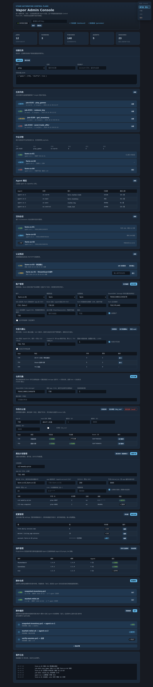
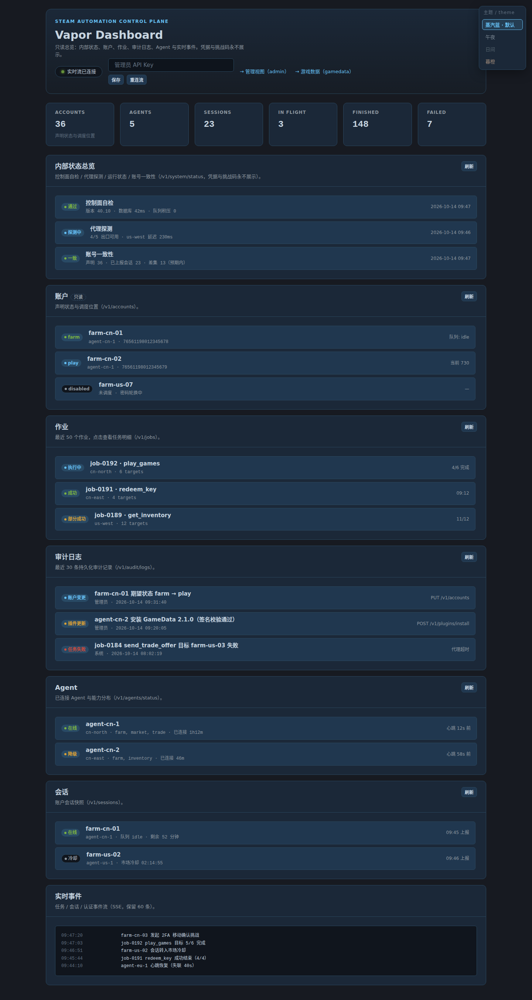
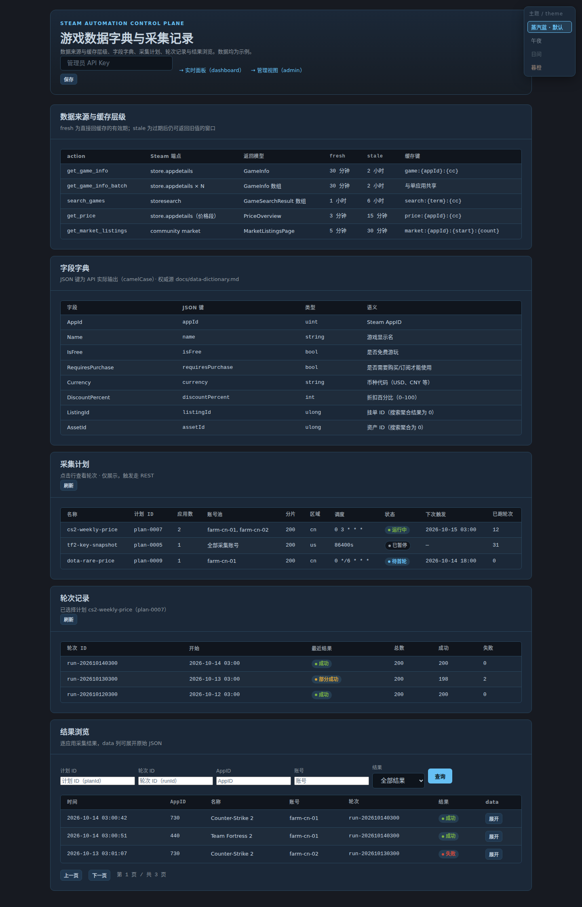
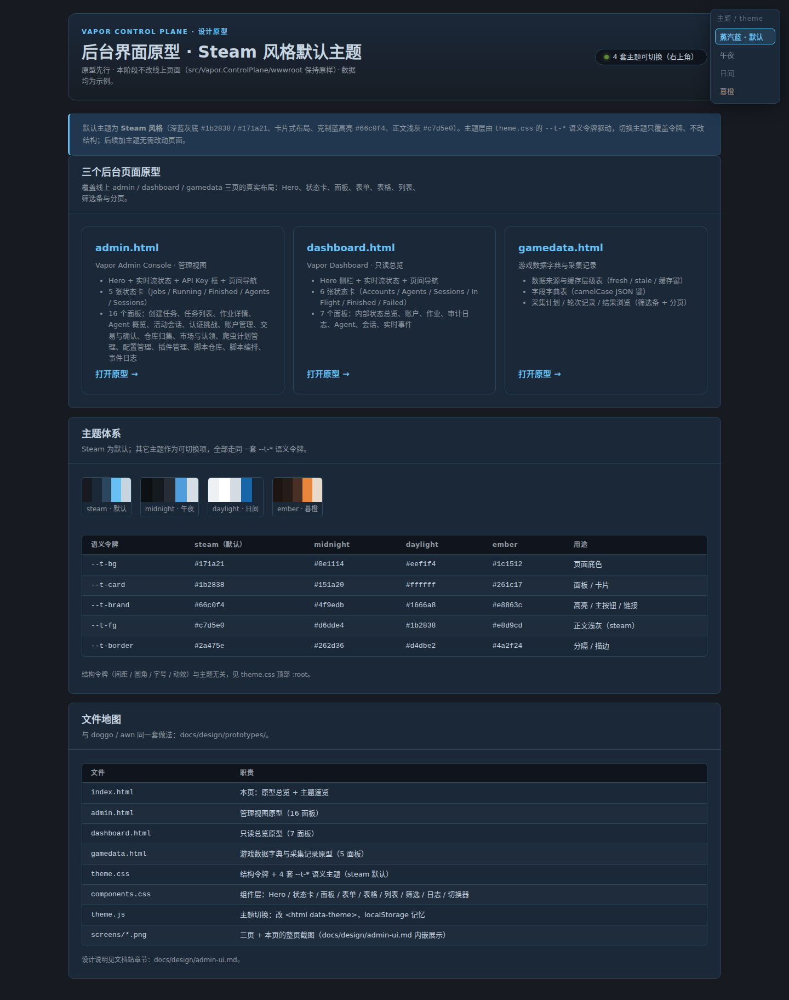

English | [简体中文](../zh/design/admin-ui/)

# Admin UI redesign (prototypes)

**Status: prototype only — live pages untouched.** The three backend pages under
`src/Vapor.ControlPlane/wwwroot/` (`admin.html` / `dashboard.html` / `gamedata.html`)
keep their current look until the operator reviews these prototypes and approves
the redesign.

## Goal

Replace the current light-green theme with a **Steam-style default theme**:
deep blue-grey background (near `#1b2838` / `#171a21`), card layout, restrained
blue highlight (near `#66c0f4`), light-grey body text (near `#c7d5e0`).

The theme layer is **tokenized CSS variables**: Steam is the default, other
themes are switchable, and adding a theme later never changes page structure.

## Page coverage

Prototypes reproduce the **real layouts** of the three pages — menus, tables,
status cards, filter bars and forms follow the actual pages, not a generic
color scheme. All data shown is sample data.

| Prototype | Real page | Coverage |
| --- | --- | --- |
| [`prototypes/admin.html`](prototypes/admin.html) | `admin.html` | Hero + stream status + API Key box + cross-page nav; 5 stat cards (Jobs / Running / Finished / Agents / Sessions); 16 panels: 创建任务, 任务列表, 作业详情, Agent 概览, 活动会话, 认证挑战, 账户管理, 交易与确认, 仓库归集, 市场与认领, 爬虫计划管理, 配置管理, 插件管理, 脚本仓库, 脚本编排, 事件日志 |
| [`prototypes/dashboard.html`](prototypes/dashboard.html) | `dashboard.html` | Hero + stream status + cross-page nav; 6 stat cards (Accounts / Agents / Sessions / In Flight / Finished / Failed); 7 panels: 内部状态总览, 账户, 作业, 审计日志, Agent, 会话, 实时事件 |
| [`prototypes/gamedata.html`](prototypes/gamedata.html) | `gamedata.html` | Hero + cross-page nav; 5 panels: 数据来源与缓存层级 (real cache table), 字段字典 (real camelCase keys), 采集计划, 轮次记录, 结果浏览 (filter bar + pager) |

The hub page [`prototypes/index.html`](prototypes/index.html) links all three and
shows the theme system at a glance.

## Theme token structure

`prototypes/theme.css` holds two layers:

- **Structural tokens** (theme-independent): `--space-*`, `--radius-*`,
  `--font-*`, `--fs-*`, `--dur-*`.
- **Semantic tokens** (`--t-*`): `--t-bg`, `--t-sunken`, `--t-card`,
  `--t-card-raised`, `--t-input-bg`, `--t-fg`, `--t-fg-muted`, `--t-fg-subtle`,
  `--t-brand`, `--t-brand-strong`, `--t-brand-soft`, `--t-on-brand`,
  `--t-hero-grad`, `--t-border`, `--t-border-strong`, `--t-success`,
  `--t-warning`, `--t-danger`, `--t-info`, `--t-table-stripe`, `--t-shadow`.

Four themes ship today; switching only overrides the `--t-*` block via
`<html data-theme="...">` (see `prototypes/theme.js`, persisted in
localStorage):

| Theme | `data-theme` | Feel |
| --- | --- | --- |
| Steam (default) | `steam` | Deep blue-grey `#171a21` / `#1b2838`, accent `#66c0f4`, text `#c7d5e0` |
| Midnight | `midnight` | Near-black neutral, low-saturation blue |
| Daylight | `daylight` | Light background, deep-blue text, same-family blue accent |
| Ember | `ember` | Warm dark, amber accent |

`prototypes/components.css` consumes only tokens — every component (hero, stat
cards, panels, field grids, tables, lists, filters, pager, event log, theme
picker) is theme-agnostic, so a new theme is one more `[data-theme="..."]`
block.

## Screenshots

Steam default theme (all four pages):

## File map

| File | Role |
| --- | --- |
| `prototypes/index.html` | Hub: overview + theme swatches + token table |
| `prototypes/admin.html` | Admin console prototype (16 panels) |
| `prototypes/dashboard.html` | Read-only dashboard prototype (7 panels) |
| `prototypes/gamedata.html` | Game data dictionary prototype (5 panels) |
| `prototypes/theme.css` | Structural tokens + 4 semantic themes (steam default) |
| `prototypes/components.css` | Component layer (token-driven) |
| `prototypes/theme.js` | Theme switcher (`data-theme` + localStorage) |
| `prototypes/screens/*.png` | Full-page screenshots of the four pages above |

## Preview

Open `prototypes/index.html` directly in a browser (no build step), or browse
the docs site at `design/prototypes/index.html`. The theme picker is fixed at
the top-right corner of every page.

## Constraints honored

- No Steam assets, icons or font files are copied — colors and layout vibe are
  referenced only; all visuals are self-drawn with CSS.
- Prototypes are static artifacts; no backend tests are required for them.
- Live pages under `src/Vapor.ControlPlane/wwwroot/` are untouched in this
  phase.
