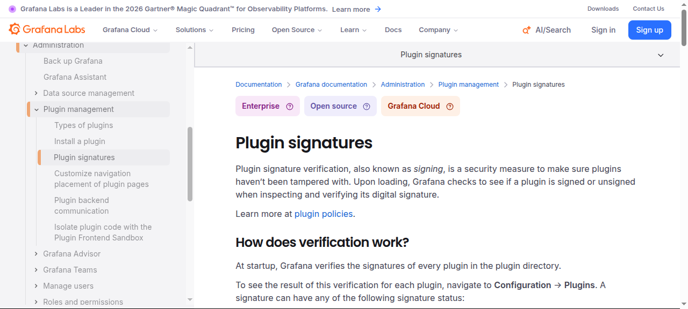
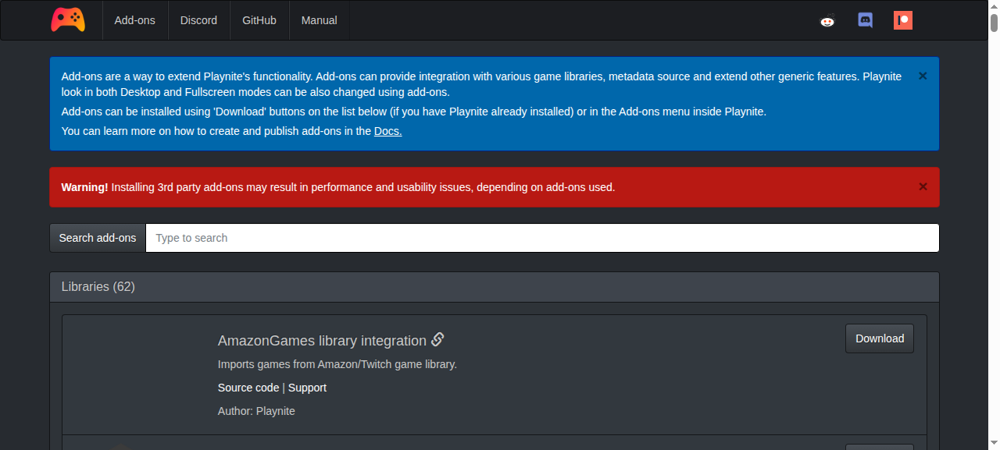
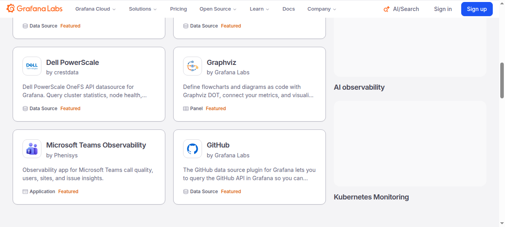

English | 简体中文

# Market Survey: Comparable Feature Points and Plugin Design (2026-10-08)

> Method: read this repo's README and docs first to confirm positioning, then pick representative products on the market. Division of labor between this comparison and `docs/feature-matrix.md`: that file is the capability-domain matrix of the five direct comparables (converged over multiple rounds since 2026-09-13); this document adds two pieces — the feature surface of adjacent categories (game libraries/launchers/save backup), and a dimension-by-dimension breakdown of plugin mechanisms. External claims carry source links; screenshots are embedded at the corresponding spot in the text and stored under `docs/research/assets/`, each noting its source and capture date (captured 2026-10-08). vapor's current state always defers to in-repo docs; no predictions are made.

## 1. Comparison Targets and Scope

vapor's positioning and endowment (from this repo's docs): an API-driven headless Steam automation platform, control plane + partitioned Agents (README); 57 actions (`docs/actions.md`), `/v1` with 58 routes / 68 operations (`docs/api.md` introduction); 6 official plugins, with a plugin mechanism covering manifests, trust, permissions, collectible ALC isolation, and a runtime PluginStore (`docs/plugins.md`).

The comparison splits into two groups, 11 products in total. **Summary**: the 5 direct comparables are checked item by item against the feature surface for gaps; the 6 baseline and adjacent products draw the "what not to build" boundary and supply the plugin-mechanism reference for section 4:

| Group | Products | Why chosen |
|----|------|-----------|
| Direct comparables (5) | [ArchiSteamFarm](https://github.com/JustArchiNET/ArchiSteamFarm/wiki), [Steam Desktop Authenticator](https://github.com/Jessecar96/SteamDesktopAuthenticator), [Watt Toolkit (Steam++)](https://github.com/BeyondDimension/SteamTools), [Steam Game Idler](https://github.com/zevnda/steam-game-idler), [steamguard-cli](https://github.com/dyc3/steamguard-cli) | All are Steam account-side automation/token tools, directly overlapping vapor's feature surface |
| Baseline and adjacent (6) | [Official Steam client](https://help.steampowered.com/en/faqs/view/7EFD-3CAE-64D3-1C31), [Playnite](https://playnite.link/), [Heroic Games Launcher](https://github.com/Heroic-Games-Launcher/HeroicGamesLauncher), [Lutris](https://github.com/lutris/lutris), [GOG Galaxy](https://github.com/gogcom/galaxy-integrations-python-api), [Ludusavi](https://github.com/mtkennerly/ludusavi) | Confirm the "what Vapor does not do" boundary, and provide the plugin-mechanism reference for section 4 (Playnite/GOG Galaxy/Heroic) |

## 2. Direct Comparables: Feature Checklist Comparison

**Conclusion**: after checking the five direct comparables row by row there is no missing feature block; the real gaps converge to three, ranked by value: plugin update checks, a Steam chat control surface, and achievement unlock pacing with refund-window awareness; all remaining differences fall outside vapor's positioning (network acceleration, local account switching, a general token vault), which `docs/feature-matrix.md` already lists separately under "explicitly not adopted".

| Product (form) | Feature list (excerpt) | vapor coverage | Gap / judgment |
|---|---|---|---|
| **ArchiSteamFarm** (C# daemon, multi-account bots) | Card farming and card switching, IPC + ASF-ui, issuing commands in Steam chat (default `!` prefix, tiered by EAccess), per-bot WebProxy, official plugins (MEF2/System.Composition convention-based discovery), official plugins auto-updated against the host version | Card farming/card switching/proxy/REST/plugins all covered, plus a multi-account fleet and desired-state orchestration (which single-process ASF lacks) | **Two real gaps**: (1) chat control surface — ASF can execute commands in Steam private/group chats ([Commands wiki](https://github.com/JustArchiNET/ArchiSteamFarm/wiki/Commands)), while vapor's interaction surface is only REST/SSE/two consoles; (2) plugin update checks — ASF official plugins auto-update against the host version (`docs/plugins.md` §Alignment), while vapor's PluginStore has only `plugin_install`/`plugin_uninstall`/`plugin_list` (`docs/plugins.md` §PluginStore) |
| **Steam Desktop Authenticator** (desktop token tool) | 2FA codes, trade/market confirmations, encrypted maFile storage, QR code sign-in; the official README states it is no longer maintained and no longer updated | TOTP, confirmations, maFile import (`import-mafile`), and QR sign-in are all covered (`docs/feature-matrix.md` §3.1) | (1) "Remove Authenticator" (with a revocation code) has no counterpart among the 57 actions, though Steam officially supports that flow ([Steam Guard FAQ](https://help.steampowered.com/en/faqs/view/7EFD-3CAE-64D3-1C31)); (2) SDA is unmaintained, so the migration window for existing maFile users is real |
| **Watt Toolkit / Steam++** (cross-platform desktop toolbox) | 3.0 supports custom plugins (default plugins can be removed or disabled), network acceleration (YARP local reverse proxy + JS injection), account switching, inventory games (simulated running for card farming, cloud save management, achievement unlocking), local tokens (TOTP/HOTP, bulk confirmations); the README's "auto card farming (ASF integration)" entry is struck through as in development | Card farming, confirmations, achievements covered; acceleration, account switching, and a general TOTP vault fall under "explicitly not adopted" (`docs/feature-matrix.md` §4) | No substantive gap. Incidental finding: the feature-matrix row "Watt embeds ASF card farming" is based on the 2026-09 version; the current README has struck it through — a point-in-time difference that can be backfilled at the next matrix maintenance |
| **Steam Game Idler** (desktop app, multi-account) | Two-phase card engine (up to 32 concurrent), skipping games inside their refund windows, blacklists/whitelists, auto card farming, achievement unlocking (humanized pacing, importable unlock schedules from others), playtime boost, inventory and market listings, free-game claims — no local Steam client needed | Farming, achievements, boost, inventory, market, and free claims all covered (`docs/feature-matrix.md` §3.2/§3.5/§3.6; achievements landed 2026-09-18) | Two detail gaps: (1) the farm queue does not recognize Steam refund windows (no refund-related implementation anywhere in the repo); (2) `unlock_achievements` is an explicit single-shot write, with no humanized pacing or unlock-schedule import. Neither blocks the GA exit criteria; both are experience-layer |
| **steamguard-cli** (Rust CLI, single account × multiple maFiles) | 2FA generation, confirmation responses, encrypted secret storage (can hook into the system keyring), QR export and QR sign-in, SDA maFile interoperability, leak-resistant in-memory data structures | Fully covered, and in a multi-account server-side form | None. Different positioning: a standalone CLI versus a server-side fleet — not the same kind of purchase decision |

## 3. Baseline and Adjacent Categories: Feature Checklist Comparison

**Conclusion**: all six are personal desktop products; none has multi-tenancy, orchestration, or an audit surface, so none competes with vapor. The transferable lessons number just two, both plugin-side — GOG Galaxy's process isolation, and Playnite's third-party extension risk notice plus catalog operations. Listing them serves to draw the boundary and to provide the plugin reference for section 4.

| Product | Feature list (excerpt) | Relationship to vapor |
|---|---|---|
| **Official Steam client** | Desktop library/downloads/store/social; Steam Guard mobile tokens (30-second code rotation, QR code sign-in, removable tokens, [official FAQ](https://help.steampowered.com/en/faqs/view/7EFD-3CAE-64D3-1C31)); trade and market confirmations ([official FAQ](https://help.steampowered.com/en/faqs/view/2E6E-A02C-5581-8904)); Steam Cloud saves ([Steamworks](https://partner.steamgames.com/doc/features/cloud)); Steam Families with up to 6 members and parental controls ([official FAQ](https://help.steampowered.com/en/faqs/view/054C-3167-DD7F-49D4)) | Outside positioning: no GUI, no game installs, no family groups. vapor runs on top of its protocols and Web API (SteamKit2 foundation, README); the Guard and confirmation loops are already closed |
| **Playnite** (open-source library manager) | Aggregates game libraries from 15+ stores and emulators, playtime tracking, metadata scraping, desktop/fullscreen dual modes; extensions split into plugins (.NET) and scripts (PowerShell), with `extension.yaml` as the manifest ([official docs](https://api.playnite.link/docs/tutorials/extensions/extensionsManifest.html)) | Library aggregation and launching are outside positioning; plugin mechanism in §4 — the add-ons page's Libraries category has 62 extensions (Figure 2) |
| **Heroic Games Launcher** | Three stores — Epic/GOG/Amazon (via Legendary, gogdl, and nile respectively), Wine/Proton management, cloud save sync, download queue, local game import; extension capability is CSS only: a custom themes directory, plus Custom CSS injection in settings ([Custom Themes wiki](https://github.com/Heroic-Games-Launcher/HeroicGamesLauncher/wiki/Custom-Themes)) | Outside positioning; a plugin counter-example, see end of §4.2 |
| **Lutris** (Python desktop client) | Automates game installs with JSON/YAML install scripts, runner (emulator/compatibility layer) management, library sync with a lutris.net account (the client stores only a token, never the password), SQLite inventory | Outside positioning. Install scripts are a data-driven DSL, a different kind of abstraction from vapor's action registry — no analogy drawn |
| **GOG Galaxy** | Desktop aggregation client; community integrations run as separate Python processes speaking JSON-RPC with the client, with `manifest.json` as the manifest and dependencies bundled with the package ([official Python API README](https://github.com/gogcom/galaxy-integrations-python-api)) | Outside positioning; the process-isolation reference, see §4.2 |
| **Ludusavi** (Rust save backup) | Backup/restore for 19,000+ games' saves, covering the Steam/GOG/Epic/Heroic/Lutris libraries, GUI + CLI, usable as a Playnite extension ([README](https://github.com/mtkennerly/ludusavi)) | Outside positioning: vapor does not touch game local files or saves |

## 4. Plugin Mechanism Survey (7 References)

The references cover three classes of host: desktop apps (VS Code, Obsidian, Playnite, Heroic), an observability platform (Grafana), and game-platform aggregation (GOG Galaxy), plus ASF, the direct ancestor of vapor's plugin mechanism.

### 4.1 Seven-Dimension Comparison Table

**Summary**: the seven hosts converge strongly — contract = manifest file + host API; versioning = the plugin declares a minimum host version; sandboxing done right relies on processes. Divergence concentrates in permissions and distribution; the per-item patterns are in §4.3.

| Reference | Contract (manifest + host API) | Discovery | Permissions and trust | Isolation / sandbox | Version compatibility | Distribution and updates |
|---|---|---|---|---|---|---|
| **VS Code** | `package.json`: required `name`/`version`/`publisher`/`engines.vscode`; `contributes` statically declares contribution points; `activationEvents` declares when activation happens ([Extension Manifest](https://code.visualstudio.com/api/references/extension-manifest)) | Marketplace or local VSIX; before activation the host can already read contribution points | No OS-level permission manifest; the gate is Workspace Trust: `capabilities.untrustedWorkspaces` declares `true`/`false`/`limited`, and undeclared extensions are disabled by default in Restricted Mode ([extension guide](https://code.visualstudio.com/api/extension-guides/workspace-trust)) | Extensions run in a separate extension host process; direct DOM access is forbidden ([Our Approach](https://vscode-docs.readthedocs.io/en/stable/extensions/our-approach/)) | `engines.vscode` takes a semantic range; `*` is forbidden | Marketplace + publisher trust prompt |
| **Grafana** | `plugin.json` required: `type` (app/datasource/panel/renderer), `dependencies.grafanaVersion` (already marked deprecated), `backend` + `executable` declaring a subprocess binary ([plugin.json reference](https://grafana.com/developers/plugin-tools/reference/plugin-json)) | Scans plugin folders containing `plugin.json` at startup | Digital signatures: plugins must be signed since Grafana 7.0; `MANIFEST.txt` carries metadata + per-file SHA256 + a private-key signature, and Grafana verifies with a built-in public key; the signature levels private/community/commercial/grafana determine distribution scope; unsigned plugins are not loaded by default ([Plugin signatures](https://grafana.com/docs/grafana/latest/administration/plugin-management/plugin-sign/)) | Backend plugins are standalone Go executables; the frontend Plugin Frontend Sandbox (public preview in ≥11.5) puts plugins in a separate JS context, off by default, with Grafana Labs' own signed plugins excluded ([sandbox docs](https://grafana.com/docs/grafana/latest/administration/plugin-management/plugin-frontend-sandbox/)) | `dependencies.grafanaVersion` declares the host version requirement | Official plugin catalog + CLI install and update |
| **Playnite** | `extension.yaml` requires `Id`/`Name`/`Version`/`Module`/`Type` (Script / GenericPlugin / GameLibrary / MetadataProvider); plugins target .NET Framework 4.6.2 ([manifest docs](https://api.playnite.link/docs/tutorials/extensions/extensionsManifest.html)) | Scans the `Extensions` directory; developers mount their output directory as External extensions | No permission model; plugins have the same rights as the host; the official add-ons page carries a third-party extension risk banner (Figure 2) | None, same-process .NET loading | The distribution manifest's `RequiredApiVersion` decides whether installation is possible; the SDK is backward compatible within a major version, SDK references are validated at load, and plugins referencing non-SDK assemblies are rejected ([plugin docs](https://api.playnite.link/docs/tutorials/extensions/plugins.html)) | Official add-on database, in-client download and updates |
| **GOG Galaxy** | `manifest.json` (`name`/`platform`/`guid`/`version`/`script`) + inheriting `galaxy.api.plugin.Plugin` ([README](https://github.com/gogcom/galaxy-integrations-python-api)) | A `plugins/installed` directory; third-party dependencies ship with the package (`pip --target`; the host bundles Python 3.13) | No declarative permissions; the capability surface is just the client-defined method set | **Each integration is a separate process**, speaking JSON-RPC with the client — the hardest boundary of the seven | The manifest `version` must match the constructor argument; no host version negotiation | Manual directory extraction; community zip distribution |
| **Obsidian** | `manifest.json`: `id`/`name`/`version` (strict `x.y.z`)/`minAppVersion`/`author`/`isDesktopOnly` ([Manifest reference](https://docs.obsidian.md/Reference/Manifest)) | `.obsidian/plugins/<id>/` + the community registry `community-plugins.json` | No permission manifest; `isDesktopOnly` is a capability declaration (must be `true` if Node/Electron is used, [submission requirements](https://docs.obsidian.md/Plugins/Releasing/Submission+requirements+for+plugins)) | None, inside the Electron renderer process | `minAppVersion` + `versions.json` recording the minimum host per release | GitHub releases + community submission review |
| **ASF** (direct ancestor) | `IPlugin` + about 22 optional capability interfaces, **no manifest file**; configuration goes through the `[JsonExtensionData]` overflow fields of `GlobalConfig.json` ([Plugins development wiki](https://github.com/JustArchiNET/ArchiSteamFarm/wiki/Plugins-development)) | System.Composition (MEF2) `[Export]` convention-based scanning | No permission model; custom plugins are fully trusted, with only a `-modded` warning | None; default load context, resident for the process lifetime | The official wiki states plainly it does not promise compiled artifacts keep working across versions; mismatches surface as `TypeLoadException` (`docs/plugins.md` §Alignment) | Manually dropped into `plugins/`; official plugins auto-update from GitHub releases against the host version (opt-in whitelist, effective after restart) |
| **Heroic** (counter-example) | No manifest, no API; only a themes directory (one `.css` per theme) and Custom CSS injection ([Custom Themes wiki](https://github.com/Heroic-Games-Launcher/HeroicGamesLauncher/wiki/Custom-Themes)) | Scans a user-specified CSS directory | Not applicable | Not applicable | Not applicable | Community theme repo submissions |

### 4.2 Host-by-Host Takeaways (Judgments Beyond the Table)

**VS Code splits "trust" and "capability" into two separate things.** Capabilities (contributes) are statically readable before activation, so the host knows which UI a plugin will occupy without running its code; trust (Workspace Trust) is a separate, independent axis deciding whether that code may run in the current workspace. The official docs themselves state this boundary does not stop malicious extensions: "Workspace Trust can't prevent a malicious extension from executing code and ignoring Restricted Mode" ([Workspace Trust](https://code.visualstudio.com/docs/editing/workspaces/workspace-trust)). Declarative trust's value is not in blocking anyone, but in making "undeclared" mean disabled by default.

**Grafana made "provenance" machine-verifiable.** The signature manifest binds metadata and file digests into a single signature; verification runs at startup, and unsigned plugins are simply not loaded. This is an order of magnitude stronger than "users verify sha256 themselves": digests no longer depend on manual transfer, and provenance and content are verified together ([Plugin signatures](https://grafana.com/docs/grafana/latest/administration/plugin-management/plugin-sign/), Figure 1). Its frontend sandbox is off by default and official plugins are exempt — evidence that even Grafana dares not promise zero-cost compatibility inside a sandbox.

**Figure 1** The Grafana signing-mechanism docs page, source text on "verify signatures at startup, tiered signature states". Source: <https://grafana.com/docs/grafana/latest/administration/plugin-management/plugin-sign/>, captured 2026-10-08.

**GOG Galaxy proves process isolation can be made routine.** Each integration is a separate Python process; the host exposes only JSON-RPC methods, dependencies ship with the package, and the host's bundled interpreter is used. The cost is process count and startup overhead; the payoff is that crashes, infinite loops, and dependency conflicts never reach the host.

**Playnite puts its version gate at install time rather than load time.** `RequiredApiVersion` is written in the distribution manifest, so the installer rejects first; at load time it then checks whether SDK references fall within the compatible major version. Two gates — the former blocks users, the latter blocks packaging mistakes. It is also the sample of "no permission model + official risk notice": a red banner at the top of the feature page warns that third-party extensions may cause performance and usability issues (Figure 2).

**Figure 2** The Playnite add-ons page: 62 extensions in the Libraries category, with the third-party extension risk notice at the top. Source: <https://playnite.link/addons.html>, captured 2026-10-08.

**ASF is the negative reference frame.** No manifest, no version negotiation, no permissions, no isolation — the cost of those four absences is written in the official wiki: "you can't assume that your plugin once compiled will keep working with all future ASF releases". On the three axes of contract, versioning, and trust, vapor's plugin mechanism fills in exactly what ASF lacks (`docs/plugins.md` §Alignment with ASF).

**Heroic shows what happens without a plugin mechanism.** Extension demand gets pushed back onto the mainline, and the community can only change looks: themes and CSS injection are its only outlet — library logic, store integrations, and the download queue are untouchable. For vapor the lesson is the reverse: a plugin mechanism is not icing on the cake; it decides whether the feature surface can keep expanding.

### 4.3 Patterns Extracted from the Seven

1. Contracts uniformly take the form "manifest file + host API"; the minimal manifest set is id, version, entry point, and capability declarations; none of the seven replaces the manifest with in-code registration.
2. Permissions come in only two flavors: none (Playnite, Obsidian, ASF — leaning on review and reputation), or declarative capabilities plus trust levels (VS Code Workspace Trust, Grafana signature levels). None provides plugins an OS-level capability sandbox.
3. Version compatibility uniformly follows "the host defines the contract, the plugin declares a minimum host version": `engines.vscode`, `RequiredApiVersion`, `minAppVersion`, and `dependencies.grafanaVersion` are isomorphic; ASF is the only one that explicitly promises nothing.
4. Sandboxing done right relies on processes: GOG Galaxy's separate processes, Grafana's standalone backend binaries, VS Code's extension host process. Same-process solutions solve version coexistence and hot unloading, not privilege overreach.
5. The three with central catalogs (VS Code, Grafana, Playnite) all pair automatic updates with risk notices (Figure 3); for the manually placed one (GOG Galaxy), updates depend on people.

**Figure 3** The Grafana plugin catalog; every card is labeled with type and author. Source: <https://grafana.com/grafana/plugins/>, captured 2026-10-08.

## 5. vapor's Plugin Mechanism vs. the References, Dimension by Dimension

**Conclusion**: of the eight dimensions, five are aligned or leading (the inter-plugin dependency graph is something none of the seven references has); isolation is weaker than the three process-based hosts; there are two real gaps — distribution has no update channel, and provenance verification stops at pinned digests. Candidate handling is in §6. Everything in the current-state column comes from `docs/plugins.md`.

| Dimension | vapor current state | Reference practice | Judgment |
|---|---|---|---|
| Contract | `plugin.json` requires `id`/`name`/`version`/`apiVersion`/`entryAssembly`, with optional `trust`/`permissions`/`configuration`/`configurationSchema`/`dependencies`; manifest parsing is lenient, validation strict, and anything invalid is reported as a load failure | Isomorphic across the seven: manifest + host API | Aligned |
| Discovery | Startup scan of `VAPOR_PLUGINS_DIR` with one subdirectory per plugin; the runtime PluginStore accepts zips for hot loading | Directory scanning dominates; the three catalog-based hosts add a central repository | Aligned for the self-hosted form; having no public catalog is a trade-off, not a defect |
| Permissions and trust | Three `trust` tiers + four `permissions` capability bits, evaluated before plugin code runs; undeclared capabilities are stripped (or rejected in strict mode) | VS Code Workspace Trust and Grafana signature levels are likewise declarative | Stronger than ASF/Playnite/Obsidian; **the capability bits only govern "what gets registered" — they do not constrain a plugin's file and network behavior while running** |
| Isolation | A collectible ALC per plugin; `plugin_uninstall` hot-unloads and verifies reclamation | GOG Galaxy separate processes, Grafana standalone backend binaries, VS Code a separate extension host process | Weaker than the three process-based hosts: an ALC does not solve privilege overreach and provides no CPU/memory quotas |
| Version compatibility | `PluginApi.IsCompatible`: major must match exactly + plugin minor ≤ host minor; the official trust tier must align precisely | `engines.vscode` / `RequiredApiVersion` / `minAppVersion` follow the same rule | Aligned; stronger than ASF (which explicitly promises nothing) |
| Configuration and dependencies | `configurationSchema` is validated before `InitializeAsync`, and a misspelled key is an outright load rejection; `dependencies` resolves a dependency graph (missing dependencies fail cascading, cycles are listed, loading is topological) | Grafana declares only the host version; the other references have essentially no inter-plugin dependencies | **None of the seven references builds an inter-plugin dependency graph — vapor leads** |
| Distribution and updates | Index URL + SHA-256 pinned digests + `plugin_install`/`plugin_uninstall`/`plugin_list` + five CP endpoints + the admin panel | All three catalog-based hosts have an update channel | **Gap**: no "check for updates / batch upgrade"; install reconciles only `pluginId`/`version`, and the index's `trust`/`permissions` are not reconciled against the in-package manifest |
| Provenance verification | Stated plainly in-repo: digests only guarantee consistency with the pinned value, not provenance; `trust` is a self-declared manifest label (`docs/plugins.md` §Trust boundary, stated plainly) | Grafana public-key signature verification, mandatory since 7.0 | A known gap; the in-repo wording is honest |

## 6. Candidate Improvements (checked items are candidates, not promises; chartering goes by `todo.md`)

- [x] **Install-time reconciliation of index and manifest (effort: low)**. `plugin_install` already reconciles the requested `pluginId`/`version` against the in-package manifest; reconcile `trust`/`permissions`/`apiVersion` as well, to guard against corrupted index entries. Basis: Grafana signs metadata and file digests into the same `MANIFEST.txt`; verifying metadata and content from the same source is standard practice (§4.2). (✅ Landed 2026-10-09 in round 58: catalog mode ships the index declarations as `expectedTrust`/`expectedPermissions`/`expectedApiVersion` with the install directive, the agent reconciles them against the in-package manifest, and disagreements aggregate into one error; see `docs/plugins.md` §Catalog reconciliation)
- [x] **Plugin update-check endpoint (medium)**. Index entries already carry `version`; adding a `plugin_update_check` (index version vs installed version, aggregated per agent) is enough for the CP panel to show "updatable". Basis: the three catalog-based hosts — VS Code, Grafana, Playnite — all have update channels, while vapor today has only install/uninstall/list as actions (§4.1). (✅ Landed 2026-10-09 in round 59: read-only host action `plugin_update_check` + `POST /v1/plugins/update-check`, the whole index shipped as candidates, the agent renders four System.Version verdicts (updateAvailable/upToDate/notComparable/notInstalled), verdicts reported with the inventory mirror, admin panel "check for updates" + "updatable" badge; see docs/plugins.md and docs/api.md §4.10)
- [x] **Runtime resource declarations (medium)**. `permissions` today only determines the registration surface; network/file usage declarations could be added to the manifest, registered into load reports and audit first, without hard enforcement for now. Basis: Obsidian's `isDesktopOnly` is the minimal "declare first, review later" sample, and VS Code's `restrictedConfigurations` is the minimal declarative-restriction sample (§4.1). (✅ Landed 2026-10-09 in round 61: the manifest gains an optional `resources` array (network/filesystem/process, lower-cased and deduped, unknown values rejected at load), pure registration with no enforcement — mirrored end to end in plugin_list and every plugin_* output, CP per-agent inventory, GET /v1/plugins/installed, and the admin panel's res badge; the five official plugins GameData/MarketWatch/GameAccess/MobileAuthenticator/Monitoring led by declaring network; see docs/plugins.md §Runtime resource declarations)
- [x] **Provenance verification upgrade (medium)**. Add publisher fingerprint or signature fields to index entries, upgrading "pinned digest" to "pinned provenance". Basis: Grafana has required signatures since 7.0 and distributes by level; unsigned is simply unsupported on the official cloud (§4.2). (✅ Landed 2026-10-13: d7f0ae5 added the `publisher` declaration (manifest + index + install reconciliation + update-check `publisherChanged` drift flag + inventory mirror + admin panel); 1b8c5df added the `signing` block (`publicKey`+`signature`, RSA-PSS over the digest as lower-case hex ASCII bytes, the agent verifies the signature after checksum and before extraction, fail-closed unless `VAPOR_PLUGIN_TRUST_KEYS` is pinned, half-declared blocks treated as undeclared, SPKI canonical comparison avoids base64 line-wrap differences, install audit records `signed`); `PluginSignatureVerifierTests` 7 + `PluginHostActionTests` integration 4+ + `PluginApiTests`/`PluginEcosystemPropertyTests` all green; see `docs/plugins.md` §Catalog reconciliation and CHANGELOG 40.10-4)
- [x] **Process/resource boundary assessment (high; assess first, build later)**. An ALC isolates only versioning and unloading; a plugin's infinite loop or runaway memory takes down the whole agent. The references are GOG Galaxy's separate processes, Grafana's standalone backend binaries, and VS Code's extension host process (§4.2). The first step is quantification, not rework: measure the resident memory and failure domains of the 6 official plugins, then decide whether processes are worth it, or step down a notch to quotas and timeout circuit breakers. (✅ Quantified and landed 2026-10-09 in round 60: the 6 official plugins hold ≈2.3MB RSS resident (managed heap only ≈45KB), so memory gives no motive for processes; the real failure-domain gap is session zombification when a plugin ignores cancellation tokens (both the per-action timeout and the 900s watchdog are cooperative cancellation, not abortable); the mechanism inventory and failure-domain matrix are in `docs/research/process-boundary.md`; process isolation is rejected as a non-goal, while poisoned-session reclamation/quotas await a decision)

## 7. Adoption Analysis

Walk the findings from sections 2-6 one by one and assign a verdict: **Adopt** = has a direct landing spot, recommend chartering; **Adapt** = the direction is sound but needs trimming to this repo's positioning or a slower pace; **Not applicable** = outside positioning, explicitly not doing. The inter-plugin dependency graph is a capability none of the seven references has and vapor has already shipped (round 54); it is left out of the table below to avoid repetition.

| Survey finding (source) | Verdict | Why | Landing suggestion |
|---|---|---|---|
| Catalog-based hosts ship update channels and risk notices as standard (VS Code / Grafana / Playnite, §4.3) | Adopt | Index entries already carry `version`; one read-only check endpoint is enough for the panel to show "updatable" — a small increment | §6 candidate 2 `plugin_update_check`; enter `todo.md` when chartered |
| Same-source verification of metadata and content (Grafana signs metadata and file digests into the same `MANIFEST.txt`, §4.2) | Adopt | The minimal form of same-source verification is install-time reconciliation; no signature infrastructure needed | §6 candidate 1, install-time reconciliation of index and manifest |
| Upgrading provenance verification to "pinned provenance" (Grafana has required signatures since 7.0 and distributes by level, §4.2) | Adapt | The direction is right, but it means building a publisher trust system of our own — beyond the cost envelope of the current self-hosted positioning | §6 candidate 4, evaluated on demand after candidate 1 |
| Splitting trust and capability into two independent axes (VS Code Workspace Trust, §4.2) | Adapt | vapor's three `trust` tiers + four `permissions` bits are already declarative; the increment is extending "undeclared = disabled by default" to the runtime resource surface | §6 candidate 3, runtime resource declarations; `docs/plugins.md` §Trust boundary |
| Process isolation can be made routine (GOG Galaxy runs one process per integration, §4.2) | Adapt | The benefit is real (crashes/infinite loops never reach the host), but process-based rework conflicts with the repo non-goal "no process sandbox"; the first step should be quantifying failure domains, not rework | §6 candidate 5's "quantify first, decide later" path; consistent with `docs/vnext-convergence-plan.md` §5 non-goals |
| A Steam chat control surface (ASF's `!`-prefixed commands, §2) | Adopt (low priority) | ASF proves it is feasible with real usage, but vapor already has REST / SSE / dual consoles — chat is an incremental entry point, not a gap-level need | Recommend chartering into `todo.md`; does not block GA |
| Humanized achievement pacing and unlock-schedule import (Steam Game Idler, §2) | Adopt (experience layer) | `unlock_achievements` as an explicit single-shot write already covers the function; humanized pacing is an anti-risk UX optimization, not a capability gap | Recommend as an experience-layer candidate in `todo.md`; margin note at `docs/feature-matrix.md` §3.5 |
| Farm queue recognizing refund windows (Steam Game Idler, §2) | Adapt | Farming a game inside its refund window is real waste; but it needs prerequisite data surfaces such as inventory/order queries | Recommend evaluating in `todo.md` in the same batch as the previous item |
| Stamping observation dates on external comparison rows (the point-in-time gap of the struck-through "embeds ASF card farming" line in Watt's README, §2) | Adapt (process) | External READMEs change; without observation dates, matrix rows cannot be audited for staleness | Backfill that row and add the date at the next `docs/feature-matrix.md` maintenance |
| Network acceleration, local account switching, a general TOTP vault (Watt, §2) | Not applicable | Desktop-toolbox territory; a server-side automation platform does not do these; `docs/feature-matrix.md` already lists them separately under "explicitly not adopted" | Keep the `docs/feature-matrix.md` §4 wording; no action |
| Library aggregation, game launching, save backup, and similar feature surfaces (Playnite / Heroic / Lutris / GOG / Ludusavi, §3) | Not applicable | Personal desktop territory, no orchestration/audit/multi-account needs; vapor does not touch local files or game launching | §3 already draws the boundary; no action |

## 8. References

**Direct comparables**

- ArchiSteamFarm:<https://github.com/JustArchiNET/ArchiSteamFarm/wiki> · Commands<https://github.com/JustArchiNET/ArchiSteamFarm/wiki/Commands> · Plugins development<https://github.com/JustArchiNET/ArchiSteamFarm/wiki/Plugins-development>
- Steam Desktop Authenticator:<https://github.com/Jessecar96/SteamDesktopAuthenticator>
- Watt Toolkit (Steam++):<https://github.com/BeyondDimension/SteamTools>
- Steam Game Idler:<https://github.com/zevnda/steam-game-idler>
- steamguard-cli:<https://github.com/dyc3/steamguard-cli>

**Baseline and adjacent**

- Steam Guard Mobile Authenticator:<https://help.steampowered.com/en/faqs/view/7EFD-3CAE-64D3-1C31> · Trade and market confirmations:<https://help.steampowered.com/en/faqs/view/2E6E-A02C-5581-8904> · Steam Families:<https://help.steampowered.com/en/faqs/view/054C-3167-DD7F-49D4> · Steam Cloud:<https://partner.steamgames.com/doc/features/cloud>
- Playnite:<https://playnite.link/> · Manifest<https://api.playnite.link/docs/tutorials/extensions/extensionsManifest.html> · Plugins<https://api.playnite.link/docs/tutorials/extensions/plugins.html> · add-ons<https://playnite.link/addons.html>
- Heroic:<https://github.com/Heroic-Games-Launcher/HeroicGamesLauncher> · Custom Themes<https://github.com/Heroic-Games-Launcher/HeroicGamesLauncher/wiki/Custom-Themes>
- Lutris:<https://github.com/lutris/lutris>
- GOG Galaxy Python API:<https://github.com/gogcom/galaxy-integrations-python-api>
- Ludusavi:<https://github.com/mtkennerly/ludusavi>

**Plugin mechanisms**

- VS Code Extension Manifest:<https://code.visualstudio.com/api/references/extension-manifest> · Workspace Trust<https://code.visualstudio.com/docs/editing/workspaces/workspace-trust> · Workspace Trust (extension guide)<https://code.visualstudio.com/api/extension-guides/workspace-trust> · Our Approach to Extensibility<https://vscode-docs.readthedocs.io/en/stable/extensions/our-approach/> · Activation Events<https://code.visualstudio.com/api/references/activation-events>
- Grafana plugin.json:<https://grafana.com/developers/plugin-tools/reference/plugin-json> · Plugin signatures<https://grafana.com/docs/grafana/latest/administration/plugin-management/plugin-sign/> · Frontend Sandbox<https://grafana.com/docs/grafana/latest/administration/plugin-management/plugin-frontend-sandbox/> · Plugin management<https://grafana.com/docs/grafana/latest/administration/plugin-management/>
- Obsidian Manifest:<https://docs.obsidian.md/Reference/Manifest> · Submission requirements<https://docs.obsidian.md/Plugins/Releasing/Submission+requirements+for+plugins>

**In-repo**

- `README.md` · `docs/feature-matrix.md` · `docs/actions.md` · `docs/api.md` · `docs/plugins.md`
